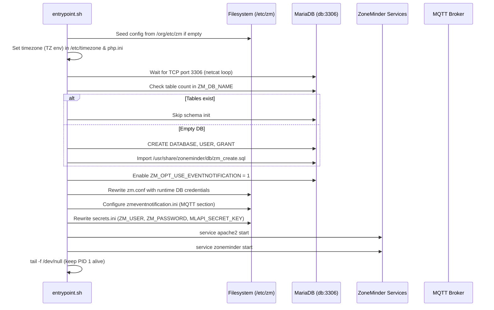

# Container Design

This document details the multi-stage Dockerfile architecture used to build the ZoneMinder container image. The build process creates a self-contained image with ZoneMinder, OpenCV (built from source), the ML API for object detection, and the zmeventnotification event server, all orchestrated by a single entrypoint script.

## Build Stages Overview

<!-- openwiki: mermaid parse failed and this diagram was converted to a text fence so it does not break rendering. Fix the diagram source and restore the mermaid fence. Parser error: Heuristic: an unescaped angle bracket inside a label breaks rendering; rephrase the label. -->
```text
flowchart TD
    A["Stage 1: opencv_builder (ubuntu:22.04)"] -->|COPY --from=opencv_builder /usr/local /usr/local| B["Stage 2: Final image (ubuntu:22.04)"]
    B --> C["Install ZM dependencies & Python stack"]
    C --> D["Install mlapi (ZoneMinder ML API)"]
    D --> E["Copy OpenCV from builder stage"]
    E --> F["Install mlapi Python requirements"]
    F --> G["Download ML models (get_models.sh)"]
    G --> H["Add ZM PPA & install zoneminder"]
    H --> I["Install zmeventnotification (Perl + install.sh)"]
    I --> J["Configure Apache (cgi, rewrite, zoneminder conf)"]
    J --> K["Copy entrypoint.sh"]
    K --> L["Backup /etc/zm -> /org/etc/zm"]
    L --> M["HEALTHCHECK & EXPOSE 80,9000"]
    M --> N["ENTRYPOINT entrypoint.sh"]
```

**Caption:** Multi-stage Dockerfile build pipeline from OpenCV compilation to final ZoneMinder runtime image.

---

## Stage 1: OpenCV Builder (`opencv_builder`)

**Base:** `ubuntu:22.04`  
**Purpose:** Compile OpenCV 4.6.0 with contrib modules from source.

### Key Characteristics

- Installs build toolchain: `build-essential`, `cmake`, `pkg-config`, and media codec libraries (`libjpeg-dev`, `libtiff-dev`, `libpng-dev`, `libavcodec-dev`, `libavformat-dev`, `libswscale-dev`, `libv4l-dev`, `libxvidcore-dev`, `libx264-dev`, `libgtk-3-dev`, `libatlas-base-dev`, `gfortran`).
- Downloads OpenCV and OpenCV contrib source from GitHub (pinned to `OPENCV_VERSION=4.6.0`).
- Configures CMake with:
  - `RELEASE` build type
  - Install prefix `/usr/local`
  - Extra modules path pointing to contrib modules
  - Python 3 bindings enabled (`BUILD_opencv_python3=ON`)
  - CUDA disabled (`WITH_CUDA=OFF`)
  - TBB enabled for parallelism (`WITH_TBB=ON`)
- Runs `make -j$(nproc)` for parallel compilation.
- Installs to `/usr/local` and runs `ldconfig`.

### Output Artifact

The entire `/usr/local` tree (headers, libraries, Python bindings) is copied into the final stage via:

```dockerfile
COPY --from=opencv_builder /usr/local /usr/local
```

This avoids shipping the build toolchain in the final image while providing a fully-featured OpenCV installation.

---

## Stage 2: Final Runtime Image

**Base:** `ubuntu:22.04` (fresh, minimal)  
**Purpose:** Assemble all runtime components on top of a clean base.

### Layer Sequence

1. **Base packages & Python stack** — `software-properties-common`, `wget`, `git`, `libmysqlclient-dev`, `mysql-client`, `python3-pip`, `python3-dev`, `python3-setuptools`, `python3-wheel`, `python3-mysql.connector`, `netcat`, `curl`.

2. **ML API dependencies** — `gcc`, `cmake`, `libev-dev`, `libevdev2`, `build-essential`, `libopenblas-dev`, `liblapack-dev`, `libblas-dev`, `git`, `wget`.

3. **OpenCV from builder** — `COPY --from=opencv_builder /usr/local /usr/local` (see above).

4. **mlapi (ZoneMinder Machine Learning API)** — Clones `https://github.com/ZoneMinder/mlapi.git` into `/usr/src/app/mlapi`, installs Python requirements via `pip3 install -r requirements.txt`. The `get_models.sh` script downloads YOLO/Object detection model weights.

5. **ZoneMinder installation** — Adds the `ppa:iconnor/zoneminder-1.36` PPA, installs `zoneminder` package, removes `mysql-server` (external DB used), installs `vim`.

6. **zmeventnotification (Event Notification Server)** — Installs Perl dependencies (`libmodule-build-perl`, `libyaml-perl`, `make`, `libprotocol-websocket-perl`, `libjson-perl`, `liblwp-protocol-https-perl`) plus CPAN modules (`Net::WebSocket::Server`, `Net::MQTT::Simple`, `Config::Inifiles`, `Crypt::MySQL`, `Crypt::Eksblowfish::Bcrypt`). Clones `https://github.com/zoneminder/zmeventnotification` to `/opt/zmeventnotification` and runs `install.sh` with flags:
   - `--install-es` — Event Server
   - `--install-hook` — Event hook script
   - `--install-config` — Configuration files
   - `--no-interactive` — Unattended
   - `--hook-config-upgrade` — Upgrade hook config
   - `--no-pysudo` — No sudo for Python

7. **Apache configuration** — Enables `cgi`, `rewrite` modules and `zoneminder` conf.

8. **Entrypoint** — Copies `entrypoint.sh` to `/usr/local/bin/`, makes executable.

9. **Config backup** — Creates `/org/etc/zm` and copies `/etc/zm/*` into it (see [Config Backup Pattern](#config-backup-pattern-orgetczm)).

10. **Healthcheck & ports** — `HEALTHCHECK` hits `http://localhost/zm/` every 60s; `EXPOSE 80 9000`.

11. **Entrypoint declaration** — `ENTRYPOINT ["entrypoint.sh"]`.

---

## Config Backup Pattern: `/org/etc/zm`

The Dockerfile creates a pristine copy of the default ZoneMinder configuration at image build time:

```dockerfile
RUN mkdir -p /org/etc/zm
RUN cp -R /etc/zm/* /org/etc/zm/
```

### Runtime Behavior (entrypoint.sh)

On container startup, the entrypoint checks whether the runtime config volume (`/etc/zm`) is empty:

```bash
if [ -z "$(ls -A /etc/zm)" ]; then
   cp -R /org/etc/zm/* /etc/zm/
fi
```

### Purpose

- **First-run initialization:** When a fresh `zm_config` volume is mounted, `/etc/zm` is empty. The entrypoint seeds it from `/org/etc/zm` so ZoneMinder starts with valid defaults.
- **Persistence:** On subsequent starts, the volume already contains customized config; the `if` guard preserves user changes.
- **Immutability of defaults:** `/org/etc/zm` remains read-only reference; never modified at runtime.

### Files Preserved

Key configuration files in `/etc/zm` (and thus backed up to `/org/etc/zm`):
- `zm.conf` — Core ZoneMinder settings (DB credentials, paths, options)
- `zmeventnotification.ini` — Event notification server config
- `secrets.ini` — API keys, ML API secret, ZoneMinder web credentials
- Apache/SSL configs under `/etc/zm/conf.d/` (if present)

---

## tmpfs Shared Memory for ZoneMinder

ZoneMinder uses `/dev/shm` for shared memory buffers between capture, analysis, and streaming processes. The docker-compose.yml mounts a `tmpfs` volume sized at ~400 MB:

```yaml
volumes:
  - type: tmpfs
    target: /dev/shm
    tmpfs:
      size: 400000000  # ~400 MB
```

### Sizing Considerations

- **Formula:** `num_cameras × resolution × color_depth × buffer_count`
- **Default 400 MB** suits ~4–6 1080p cameras with modest buffer counts.
- **Increase** if you see `shmget` failures or "No space left on device" in ZM logs.
- **Decrease** for memory-constrained hosts (minimum ~64 MB for a single low-res camera).

The `tmpfs` mount is backed by host RAM (not disk), so size directly consumes container memory limit. Ensure the container's memory limit (if set) exceeds this value.

---

## Entrypoint Orchestration

`entrypoint.sh` is the single PID 1 process that initializes the environment and launches all services.

### Execution Flow



**Caption:** Entrypoint initialization sequence from config seeding to service startup.

### Detailed Steps

| Phase | Action | Details |
|-------|--------|---------|
| **Config seeding** | `cp -R /org/etc/zm/* /etc/zm/` | Only if `/etc/zm` empty (first run on volume). |
| **Timezone** | `TZ` → `/etc/timezone`, `/etc/localtime`, all `php.ini` `date.timezone` | Uses `dpkg-reconfigure tzdata`. |
| **DB wait** | `netcat -z ${ZM_DB_HOST} 3306` loop | Blocks until MariaDB accepts connections. |
| **DB init** | `mysql` table count check | Creates schema + user + imports `zm_create.sql` if empty. |
| **Feature flag** | `UPDATE Config SET Value='1' WHERE Name='ZM_OPT_USE_EVENTNOTIFICATION'` | Enables event notification integration. |
| **zm.conf rewrite** | `sed` replacements for `ZM_DB_HOST`, `ZM_DB_USER`, `ZM_DB_PASS`, `ZM_DB_NAME` | Runtime values override baked-in defaults. |
| **zmeventnotification.ini** | If `MQTT_HOST` set: enable MQTT section, set server/user/password/retain, disable SSL | Dynamic config for event server. |
| **secrets.ini** | Replace portal URL, `ZM_USER`, `ZM_PASSWORD`, generate `MLAPI_SECRET_KEY` | `openssl rand -base64 32` for ML API auth. |
| **Service start** | `service apache2 start` → `service zoneminder start` | Apache serves ZM web UI; ZM daemons start capture/analysis. |
| **Keep alive** | `tail -f /dev/null` | Prevents container exit; PID 1 stays alive. |

### Environment Variables Consumed

| Variable | Used By | Required |
|----------|---------|----------|
| `TZ` | Timezone setup | No (defaults to UTC) |
| `ZM_DB_HOST` | DB wait, zm.conf, schema init | Yes |
| `ZM_DB_NAME` | DB init, zm.conf | Yes |
| `ZM_DB_USER` | DB init, zm.conf | Yes |
| `ZM_DB_PASS` | DB init, zm.conf | Yes |
| `MYSQL_ROOT_PASSWORD` | DB creation (root login) | Yes |
| `ZM_USER` | secrets.ini, ZM auth | Yes |
| `ZM_PASSWORD` | secrets.ini, ZM auth | Yes |
| `MQTT_HOST` | zmeventnotification.ini MQTT enable | No |
| `MQTT_USER` | zmeventnotification.ini | If MQTT_HOST set |
| `MQTT_PASSWORD` | zmeventnotification.ini | If MQTT_HOST set |

### Services NOT Started by Entrypoint

- **ML API (`mlapi.py`)** — Commented out in entrypoint (`#python3 /usr/src/app/mlapi/mlapi.py -c mlapiconfig.ini`). Typically run as a separate container or process.
- **zmeventnotification.pl** — Commented out (`#./zmeventnotification.pl ...`). The install.sh sets up systemd-style service files; in this container it's expected to be started via ZoneMinder's `zmtrigger.pl` hook or a separate supervisor.

---

## Network Ports

| Port | Service | Protocol |
|------|---------|----------|
| 80 | Apache / ZoneMinder Web UI | HTTP |
| 9000 | ZoneMinder API / WebSocket | HTTP/WS |
| 1883 | Mosquitto MQTT (separate container) | MQTT |
| 9001 | Mosquitto WebSocket (separate container) | WS |

The ZoneMinder container exposes 80 and 9000. The MQTT broker runs in a separate `eclipse-mosquitto` container (see `docker-compose.yml`).

---

## Volumes

| Volume | Mount Path | Purpose |
|--------|------------|---------|
| `zm_config` | `/etc/zm` | ZoneMinder config (seeded from `/org/etc/zm`) |
| `zm_cache` | `/var/cache/zoneminder` | Cached images, thumbnails, video |
| `known_faces` | `/var/lib/zmeventnotification/known_faces` | Face recognition reference images |
| `unknown_faces` | `/var/lib/zmeventnotification/unknown_faces` | Unrecognized face crops |
| `tmpfs` | `/dev/shm` | Shared memory for ZM buffers (~400 MB) |

---

## Healthcheck

```dockerfile
HEALTHCHECK --interval=1m --timeout=10s --retries=3 \
    CMD curl -f http://localhost/zm/ || exit 1
```

- Probes the ZoneMinder web root every 60 seconds.
- 10-second timeout, 3 retries before marking unhealthy.
- Depends on Apache being up; will fail during initial DB init phase (acceptable).

---

## Extending the Image

### Adding Custom OpenCV Modules

Modify the `opencv_builder` stage CMake flags (e.g., enable `WITH_CUDA=ON`, add `-D OPENCV_EXTRA_MODULES_PATH=...` for local modules).

### Pinning Versions

- `OPENCV_VERSION` arg in builder stage.
- `ZONEMINDERVERSION` (PPA suffix) in final stage.
- mlapi / zmeventnotification Git refs (currently `master` via `git clone`); pin to tags for reproducibility.

### Multi-Arch Builds

Use `docker buildx` with `--platform linux/amd64,linux/arm64`. The OpenCV build stage is the heaviest; consider pre-built OpenCV base images for ARM to reduce build time.

---

## Related Pages

- [ML Pipeline](../architecture/ml-pipeline.md) — ML API model loading and inference flow.
- [System Overview](../architecture/system-overview.md) — Full architecture diagram and service relationships.
- [Entrypoint Flow](../operations/entrypoint-flow.md) — Detailed entrypoint.sh execution trace and troubleshooting.
