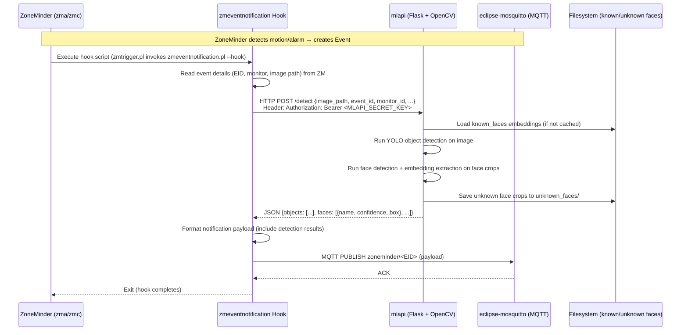

# ML/AI Pipeline

This document describes the machine learning pipeline integrated into the ZoneMinder container: the **ML API (mlapi)** for object detection, **OpenCV** as the computer vision backend, **face recognition models**, and the **event hook** flow that connects ZoneMinder events to ML inference and MQTT publishing. It also draws the critical line between artifacts that are **baked into the image at build time** (model weights, OpenCV) and data that is **runtime-persistent in named volumes** (known and unknown face images), and documents what the entrypoint actually starts — which is less than the full pipeline.

## Architecture Overview

<!-- openwiki: mermaid parse failed and this diagram was converted to a text fence so it does not break rendering. Fix the diagram source and restore the mermaid fence. Parser error: Heuristic: an unescaped angle bracket inside a label breaks rendering; rephrase the label. -->
```text
flowchart TD
    ZM["ZoneMinder\n(zma, zmc)"] -->|Event trigger| HOOK["zmeventnotification Hook\n(zmeventnotification.pl --hook)"]
    HOOK -->|HTTP POST /detect| MLAPI["mlapi\n(Python Flask + OpenCV)"]
    MLAPI -->|Load models| MODELS["Model Weights\n(YOLO, face embeddings)"]
    MLAPI -->|Read known faces| KNOWN["known_faces Volume\n/var/lib/zmeventnotification/known_faces"]
    MLAPI -->|Write unknown crops| UNKNOWN["unknown_faces Volume\n/var/lib/zmeventnotification/unknown_faces"]
    MLAPI -->|JSON results| HOOK
    HOOK -->|MQTT Publish| MQTT["eclipse-mosquitto\nTopic: zoneminder/<eid>"]
    MQTT -->|Consume| NOTIFY["Notification Clients\n(Home Assistant, pushover, etc.)"]
```

**Caption:** ML inference pipeline from ZoneMinder event to MQTT notification.

---

## Component Responsibilities

| Component | Role | Location |
|-----------|------|----------|
| **mlapi** | Machine-learning API service (Python, cloned from `ZoneMinder/mlapi`) providing object detection and face recognition over OpenCV | `/usr/src/app/mlapi/` |
| **OpenCV 4.6.0** | Computer vision library with the DNN module; built from source with contrib modules for face recognition | `/usr/local` (copied from the builder stage) |
| **zmeventnotification** | Event server and hook installed from `zoneminder/zmeventnotification`; the hook calls mlapi on events and publishes results to MQTT | `/opt/zmeventnotification/` |
| **known_faces volume** | Persistent storage for reference face images, organized for the face-recognition tooling | `/var/lib/zmeventnotification/known_faces` |
| **unknown_faces volume** | Storage for crops of unrecognized faces, for manual review/labeling | `/var/lib/zmeventnotification/unknown_faces` |

---

## Build-Time Artifacts vs Runtime-Persistent Volumes

A key property of this container is that the two halves of the ML pipeline have completely different lifecycles:

### Baked into the image (build time)

- **OpenCV 4.6.0** is compiled from source in the `opencv_builder` stage and copied into the final image (`COPY --from=opencv_builder /usr/local /usr/local`). Rebuilding the image is the only way to change the OpenCV version or build options.
- **Model weights** are downloaded during the Docker build by the mlapi repository's `get_models.sh` script (`RUN ./get_models.sh`). They are placed inside the mlapi working directory and are part of the image layer.
- Because models are baked in, **updating YOLO or face models requires rebuilding the image** (or modifying the mlapi clone / `get_models.sh` and re-running the build). The volumes hold no model weights.

### Runtime-persistent volumes (state that survives recreation)

`docker-compose.yml` mounts two named volumes into the zoneminder service:

```yaml
volumes:
  - zm_config:/etc/zm
  - zm_cache:/var/cache/zoneminder
  - known_faces:/var/lib/zmeventnotification/known_faces
  - unknown_faces:/var/lib/zmeventnotification/unknown_faces
```

and declares them alongside the other named volumes (`known_faces:`, `unknown_faces:` in the top-level `volumes:` block). Because they are named volumes, the face data persists across container recreation, while the model weights would be reset by a rebuild.

- **known_faces** (`/var/lib/zmeventnotification/known_faces`): reference images of known individuals, conventionally organized as one subdirectory per person (e.g. `known_faces/John/`). It is manually curated by administrators — typically by placing images directly into the volume — and the face-recognition tooling builds its reference embeddings from this tree.
- **unknown_faces** (`/var/lib/zmeventnotification/unknown_faces`): where face crops that do not match any known identity are stored for review. The operational feedback loop is to inspect this directory and move crops into `known_faces/<name>/` to teach the system new identities.

---

## MLAPI_SECRET_KEY Generation and Role

On every startup where `/etc/zm/zmeventnotification.ini` exists, `entrypoint.sh` generates a cryptographically random secret for mlapi authentication:

```bash
SECRET_KEY=$(openssl rand -base64 32)
if grep -q 'MLAPI_SECRET_KEY' /etc/zm/secrets.ini; then
  sed -i "s/^MLAPI_SECRET_KEY=.*/MLAPI_SECRET_KEY=${SECRET_KEY}/" /etc/zm/secrets.ini
else
  echo "MLAPI_SECRET_KEY=${SECRET_KEY}" >> /etc/zm/secrets.ini
fi
```

The key's role:

- It is the shared **authentication token** for the mlapi REST endpoints.
- The zmeventnotification hook reads it from `/etc/zm/secrets.ini` and presents it when calling mlapi.
- It is regenerated on **every container start** (the entrypoint runs at PID 1 each time), so the secret rotates on restart.
- Consequently, mlapi and the hook must see the **same `secrets.ini`** — in this design both live in the same container backed by the `zm_config` volume. If you split mlapi into a separate container, you must either mount the same `zm_config` volume there, or set a fixed `MLAPI_SECRET_KEY` in your `.env` and modify the entrypoint to stop regenerating it.

---

## Event Hook Flow: ZM Event → Hook → mlapi → MQTT

The designed end-to-end flow is:



**Caption:** Sequence diagram showing the end-to-end flow from ZoneMinder event through ML inference to MQTT notification.

### Detailed Steps

1. **ZoneMinder Event Creation** — When a monitor detects motion or an alarm condition, ZoneMinder creates an event record (EID) and writes the alarm frame image to disk.

2. **Hook Invocation** — The entrypoint ensures the ZoneMinder option `ZM_OPT_USE_EVENTNOTIFICATION` is set to `1` in the `Config` table, so ZoneMinder's event notification subsystem is active and invokes the zmeventnotification hook on events.

3. **Hook → mlapi Request** — The hook constructs an HTTP request to mlapi with the image/event context and authenticates with `Authorization: Bearer <MLAPI_SECRET_KEY>`, read from `/etc/zm/secrets.ini`.

4. **mlapi Inference** — mlapi loads the image via the OpenCV DNN backend and runs:
   - **Object detection** using the YOLO weights downloaded by `get_models.sh` at build time.
   - **Face detection and recognition** — detecting faces, computing embeddings, and comparing them against the reference embeddings built from `known_faces/`.

5. **Face Storage Side Effects** —
   - Recognized faces are returned in the response with a name and confidence.
   - Unrecognized faces are cropped and saved to `unknown_faces/` for later review and labeling.

6. **Response** — mlapi returns its detection results as JSON to the hook.

7. **Hook → MQTT** — The hook enriches the event payload with the detection results and publishes it to the configured MQTT broker. The broker (`eclipse-mosquitto` service) fans out to subscribers (Home Assistant, custom notifiers, etc.).

> **Important:** this is the *designed* flow. As described below, neither mlapi nor the event notification daemon is actually launched by the entrypoint in the current image, so out of the box the inference and push legs of this flow must be started manually.

---

## Runtime Wiring: What the Entrypoint Actually Starts

`entrypoint.sh` performs the ML/notification *configuration* but deliberately does **not** start the ML or notification daemons:

- The mlapi launch line is commented out:
  ```bash
  #python3 /usr/src/app/mlapi/mlapi.py -c mlapiconfig.ini
  ```
- The event notification server launch is likewise commented out:
  ```bash
  #cd /opt/zmeventnotification
  #./zmeventnotification.pl --debug --config /etc/zm/zmeventnotification.ini
  ```

What the entrypoint does start, after configuring the database and `zmeventnotification.ini`/`secrets.ini`:

```bash
service apache2 start
service zoneminder start

# Keep the container running
tail -f /dev/null
```

So the container out of the box runs ZoneMinder (via Apache + the `zoneminder` service) with event notification enabled in the ZoneMinder configuration, and it writes a fresh `MLAPI_SECRET_KEY`. To get the full ML pipeline running you must either start `mlapi.py` and `zmeventnotification.pl` yourself (uncomment the lines, run them under a supervisor, or execute them manually), or run mlapi as a separate container/process and point the hook's mlapi configuration at it (sharing `secrets.ini` or pinning the key as described above).

Other entrypoint wiring relevant to this pipeline:

- `ZM_OPT_USE_EVENTNOTIFICATION` is set to `1` in the ZoneMinder database `Config` table after the schema is ensured.
- When `MQTT_HOST` is set, the `[mqtt]` section of `/etc/zm/zmeventnotification.ini` is rewritten: `enable = yes`, `server = $MQTT_HOST`, `username`/`password` from `MQTT_USER`/`MQTT_PASSWORD`, `retain = yes`; and the `[ssl]` section is set to `enable = no` (plain MQTT on the internal network).
- `secrets.ini` is adjusted: the portal URL `https://portal/` is replaced with `http://zoneminder/`, and `ZM_USER`/`ZM_PASSWORD` are set from the environment — these are the credentials the hook uses to reach the ZoneMinder portal.
- The broker itself is provisioned by the separate mosquitto image: `Dockerfile.mosquitto` builds from `eclipse-mosquitto:latest`, and `entrypoint_mosquitto.sh` writes a `mosquitto.conf` (listener 1883, password file, persistence under `/mosquitto/data/`) and creates the credential file with `mosquitto_passwd -b ... $MQTT_USER $MQTT_PASSWORD`. The compose override exposes `1883` and `9001` and maps ZoneMinder's web UI/ENP ports to `7080`/`7000` on the host.

---

## Model Acquisition (get_models.sh)

During the Docker build, the mlapi repository's `get_models.sh` script runs as part of the image layer:

```dockerfile
WORKDIR /usr/src/app/mlapi
RUN git clone https://github.com/ZoneMinder/mlapi.git .
RUN pip3 install --no-cache-dir -r requirements.txt
RUN ./get_models.sh
```

This downloads the mlapi model set (YOLO object-detection weights and configuration, plus the face detection/embedding models) into the mlapi working directory, where they are loaded at runtime. Because the download happens in a `RUN` layer, the weights are **baked into the image** — they are not stored in any volume, and updating them means rebuilding the image. Model management strategies are covered in [ML Model Management](../operations/ml-model-management.md).

---

## OpenCV Build Configuration

OpenCV 4.6.0 (`OPENCV_VERSION=4.6.0`) is compiled from source in the dedicated `opencv_builder` stage (Ubuntu 22.04) with these key options:

| CMake Option | Value | Reason |
|--------------|-------|--------|
| `BUILD_opencv_python3` | ON | Python bindings for mlapi |
| `BUILD_opencv_python2` | OFF | Python 2 not needed |
| `WITH_CUDA` | OFF | CPU-only inference; smaller, portable image |
| `WITH_TBB` | ON | Threading Building Blocks for parallel processing |
| `OPENCV_EXTRA_MODULES_PATH` | `/opt/opencv_contrib-4.6.0/modules` | Adds opencv_contrib modules, including the face module used for face recognition |
| `CMAKE_INSTALL_PREFIX` | `/usr/local` | Install tree copied verbatim into the final image |

Docs, examples, tests, and perf tests are disabled (`BUILD_DOCS=OFF`, `BUILD_EXAMPLES=OFF`, `BUILD_TESTS=OFF`, `BUILD_PERF_TESTS=OFF`). The compiled `/usr/local` tree (libraries, headers, and the `cv2` Python module) is copied into the final stage, providing the DNN backend that mlapi uses for both object detection and face recognition.

---

## Configuration Files

| File | Purpose | Pipeline-relevant contents |
|------|---------|---------------------------|
| `/etc/zm/secrets.ini` | Shared secrets for the hook and mlapi | `MLAPI_SECRET_KEY`, `ZM_USER`, `ZM_PASSWORD`, portal URL — rewritten by the entrypoint at startup |
| `/etc/zm/zmeventnotification.ini` | Event server and hook configuration | `[mqtt]` (broker host/credentials, retain) and `[ssl]` are rewritten from environment variables by the entrypoint; hook and mlapi settings live here per the upstream zmeventnotification layout |
| `/usr/src/app/mlapi/mlapiconfig.ini` | mlapi runtime configuration | mlapi's own settings (listen port, model paths, face recognition confidence threshold) per the upstream mlapi layout; the entrypoint's commented launch line references this file |

---

## Operational Notes

- **mlapi is not started by `entrypoint.sh`** — the `python3 /usr/src/app/mlapi/mlapi.py -c mlapiconfig.ini` line is commented out. Start it manually, via a supervisor, or as a separate container (sharing `zm_config` or a pinned key).
- **`zmeventnotification.pl` is also not started** — the event server daemon (WebSocket/push side) launch is commented out as well; only Apache and the ZoneMinder service run out of the box.
- **Face recognition threshold** — configured in mlapi's own config (`mlapiconfig.ini`). Typical working ranges are around 0.6–0.8: lower values match more loosely (more false positives), higher values are stricter.
- **Model updates** — modify `get_models.sh` or the mlapi repository reference, then rebuild the image. Volumes only store face *reference images* (and unknown-face crops), never model weights.
- **Secret rotation caveat** — because `MLAPI_SECRET_KEY` changes on every start, any external mlapi instance must either share the `zm_config` volume or use a fixed key; otherwise hook→mlapi authentication breaks after a restart.

---

## Related Pages

- [Container Design](./container-design.md) — Multi-stage Dockerfile and build details, including the OpenCV builder stage and the mosquitto image.
- [Event Notifications & MQTT](../integrations/event-notifications.md) — MQTT topic structure, `secrets.ini`, and hook configuration in depth.
- [ML Model Management](../operations/ml-model-management.md) — Volume usage, model update strategies, OpenCV version pinning.
- [Troubleshooting](../operations/troubleshooting.md) — Diagnosing mlapi, hook, and MQTT issues (including `MLAPI_SECRET_KEY` rotation problems).
