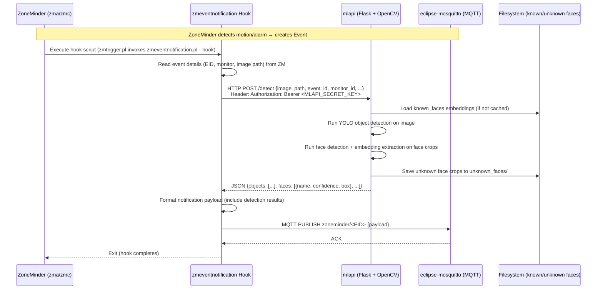

# ML/AI Pipeline

This document describes the machine learning pipeline integrated into the ZoneMinder container: the **ML API (mlapi)** for object detection, **OpenCV** as the computer vision backend, **face recognition models** managed via `zmeventnotification`, and the **event hook** flow that connects ZoneMinder events to ML inference and MQTT publishing.

## Architecture Overview

<!-- openwiki: mermaid parse failed and this diagram was converted to a text fence so it does not break rendering. Fix the diagram source and restore the mermaid fence. Parser error: Heuristic: an unescaped angle bracket inside a label breaks rendering; rephrase the label. -->
```text
flowchart TD
    ZM["ZoneMinder\n(zma, zmc)"] -->|Event trigger| HOOK["zmeventnotification Hook\n(zmeventnotification.pl --hook)"]
    HOOK -->|HTTP POST /detect| MLAPI["mlapi\n(Python Flask + OpenCV)"]
    MLAPI -->|Load models| MODELS["Model Weights\n(YOLO, face embeddings)"]
    MLAPI -->|Read known faces| KNOWN["known_faces Volume\n/var/lib/zmeventnotification/known_faces"]
    MLAPI -->|Write unknown crops| UNKNOWN["unknown_faces Volume\n/var/lib/zmeventnotification/unknown_faces"]
    MLAPI -->|JSON results| HOOK
    HOOK -->|MQTT Publish| MQTT["eclipse-mosquitto\nTopic: zoneminder/<eid>"]
    MQTT -->|Consume| NOTIFY["Notification Clients\n(Home Assistant, pushover, etc.)"]
```

**Caption:** ML inference pipeline from ZoneMinder event to MQTT notification.

---

## Component Responsibilities

| Component | Role | Location |
|-----------|------|----------|
| **mlapi** | Flask REST API wrapping OpenCV DNN for object detection (YOLO) and face recognition (face embeddings) | `/usr/src/app/mlapi/` |
| **OpenCV 4.6.0** | Computer vision library with DNN module; built from source with contrib modules for face recognition | `/usr/local/` (copied from builder stage) |
| **zmeventnotification hook** | Perl script invoked by ZoneMinder's `zmtrigger.pl` on each event; calls mlapi, publishes results to MQTT | `/opt/zmeventnotification/` |
| **known_faces volume** | Persistent storage for reference face images (one subdirectory per person) | `/var/lib/zmeventnotification/known_faces` |
| **unknown_faces volume** | Crops of unrecognized faces for manual review/labeling | `/var/lib/zmeventnotification/unknown_faces` |

---

## Model Storage Paths

The `docker-compose.yml` defines two named volumes for face recognition data:

```yaml
volumes:
  - known_faces:/var/lib/zmeventnotification/known_faces
  - unknown_faces:/var/lib/zmeventnotification/unknown_faces
```

### known_faces
- **Path:** `/var/lib/zmeventnotification/known_faces`
- **Purpose:** Stores reference images for known individuals. Each person gets a subdirectory (e.g., `known_faces/John/`). The face recognition model computes embeddings for these images at startup or on reload.
- **Population:** Manually curated by administrators; can be added via ZoneMinder UI or by placing images directly in the volume.

### unknown_faces
- **Path:** `/var/lib/zmeventnotification/unknown_faces`
- **Purpose:** When face recognition detects a face that doesn't match any known person (below confidence threshold), the cropped face image is saved here for review.
- **Usage:** Operators can inspect this directory, move crops into `known_faces/<name>/` to teach the system new identities.

Both volumes are backed by Docker named volumes (`known_faces`, `unknown_faces`), so data persists across container recreates.

---

## MLAPI_SECRET_KEY Generation and Role

The `entrypoint.sh` generates a cryptographically random secret for mlapi authentication:

```bash
SECRET_KEY=$(openssl rand -base64 32)
if grep -q 'MLAPI_SECRET_KEY' /etc/zm/secrets.ini; then
  sed -i "s/^MLAPI_SECRET_KEY=.*/MLAPI_SECRET_KEY=${SECRET_KEY}/" /etc/zm/secrets.ini
else
  echo "MLAPI_SECRET_KEY=${SECRET_KEY}" >> /etc/zm/secrets.ini
fi
```

### Role
- **Authentication token** for the mlapi REST endpoint (`/detect`, `/train`, etc.).
- The `zmeventnotification` hook reads this key from `secrets.ini` and includes it in the `Authorization` header when calling mlapi.
- Generated fresh on **every container startup** (since `entrypoint.sh` runs at PID 1 each time). This means:
  - The secret rotates on restart (security benefit).
  - mlapi and the hook must be in the same container (or share the same `secrets.ini` via volume) to stay in sync.
- If mlapi runs in a separate container, you must either:
  - Mount the same `zm_config` volume so both see the same `secrets.ini`, or
  - Set a fixed `MLAPI_SECRET_KEY` in your `.env` and modify entrypoint to not regenerate it.

---

## Event Hook Flow: ZM Event → Hook → mlapi → MQTT



**Caption:** Sequence diagram showing the end-to-end flow from ZoneMinder event through ML inference to MQTT notification.

### Detailed Steps

1. **ZoneMinder Event Creation** — When a monitor detects motion or an alarm condition, ZoneMinder's analysis daemon (`zma`) creates an event record (EID) and writes the alarm frame image to disk.

2. **Hook Invocation** — ZoneMinder's `zmtrigger.pl` (configured via `ZM_OPT_USE_EVENTNOTIFICATION=1`) executes the hook script: `zmeventnotification.pl --hook --event <EID> --monitor <MID> ...`

3. **Hook → mlapi Request** — The hook constructs an HTTP POST to mlapi (default `http://localhost:5000/detect`) with:
   - `image_path`: Path to the alarm frame image
   - `event_id`, `monitor_id`: Identifiers
   - `Authorization: Bearer <MLAPI_SECRET_KEY>` header (read from `/etc/zm/secrets.ini`)

4. **mlapi Inference** — mlapi (Flask app) loads the image via OpenCV, runs:
   - **Object detection** using YOLO (weights downloaded by `get_models.sh` at build time)
   - **Face detection** using OpenCV DNN face detector
   - **Face recognition** by computing embeddings for detected faces and comparing against cached known_faces embeddings

5. **Face Storage Side Effects** —
   - Recognized faces: returned in JSON with name and confidence.
   - Unrecognized faces: cropped and saved to `unknown_faces/` with timestamped filenames.

6. **Response** — mlapi returns JSON: `{objects: [...], faces: [{name, confidence, box, ...}, ...]}`

7. **Hook → MQTT** — The hook enriches the event payload with detection results and publishes to MQTT topic `zoneminder/<EID>` (or configured topic prefix). The MQTT broker (`eclipse-mosquitto`) fans out to subscribers (Home Assistant, custom notifiers, etc.).

---

## Model Acquisition (get_models.sh)

During the Docker build, the mlapi repository's `get_models.sh` script runs:

```dockerfile
WORKDIR /usr/src/app/mlapi
RUN git clone https://github.com/ZoneMinder/mlapi.git .
RUN pip3 install --no-cache-dir -r requirements.txt
RUN ./get_models.sh
```

This downloads:
- **YOLO weights** (e.g., `yolov4-tiny.weights`, `yolov4-tiny.cfg`, `coco.names`) for object detection
- **Face detection model** (OpenCV DNN face detector prototxt/caffemodel)
- **Face embedding model** (OpenFace `nn4.small2.v1.t7` Torch model)

Models are placed in the mlapi working directory (`/usr/src/app/mlapi/`) and loaded at runtime. They are **baked into the image** (not stored in volumes), so updating models requires rebuilding the image.

---

## OpenCV Build Configuration

OpenCV 4.6.0 is compiled from source in the `opencv_builder` stage with these key options:

| CMake Option | Value | Reason |
|--------------|-------|--------|
| `BUILD_opencv_python3` | ON | Python bindings for mlapi |
| `WITH_CUDA` | OFF | CPU-only inference; smaller image |
| `WITH_TBB` | ON | Threading Building Blocks for parallel inference |
| `OPENCV_EXTRA_MODULES_PATH` | `/opt/opencv_contrib-4.6.0/modules` | Enables `face` module (facerec, Fisherfaces, LBPH) |

The compiled `/usr/local` tree (libs, headers, `cv2` Python module) is copied to the final stage. This provides the DNN backend that mlapi uses for both YOLO and face recognition.

---

## Configuration Files

| File | Purpose | Key Sections |
|------|---------|--------------|
| `/etc/zm/secrets.ini` | Shared secrets for ZM, hook, mlapi | `MLAPI_SECRET_KEY`, `ZM_USER`, `ZM_PASSWORD`, portal URL |
| `/etc/zm/zmeventnotification.ini` | Hook & event server config | `[hook]`, `[mqtt]`, `[mlapi]` (mlapi URL, timeout) |
| `/usr/src/app/mlapi/mlapiconfig.ini` | mlapi runtime config | `listen_port`, `model_paths`, `face_recognition_threshold` |

The entrypoint rewrites `secrets.ini` and `zmeventnotification.ini` at startup with runtime environment variables (`MQTT_HOST`, `ZM_USER`, etc.).

---

## Operational Notes

- **mlapi is not started by entrypoint.sh** — The line `python3 /usr/src/app/mlapi/mlapi.py -c mlapiconfig.ini` is commented out. In this architecture, mlapi is expected to run as a separate process/container, or you must uncomment and manage it via a process supervisor (supervisord, systemd-in-container, etc.).
- **zmeventnotification.pl is also not started** — The hook runs on-demand via `zmtrigger.pl`; the event server daemon (for WebSocket push) is not launched by the entrypoint.
- **Face recognition threshold** — Configured in `mlapiconfig.ini` (`face_min_confidence`). Typical values: 0.6–0.8. Lower = more matches (more false positives); higher = stricter.
- **Model updates** — To update YOLO or face models, modify `get_models.sh` or the mlapi repo reference, then rebuild the image. Volumes only store face *reference images*, not model weights.

---

## Related Pages

- [Container Design](./container-design.md) — Multi-stage Dockerfile and build details.
- [Event Notifications & MQTT](../integrations/event-notifications.md) — MQTT topic structure, secrets.ini, hook configuration.
- [ML Model Management](../operations/ml-model-management.md) — Volume usage, model update strategies, OpenCV version pinning.
