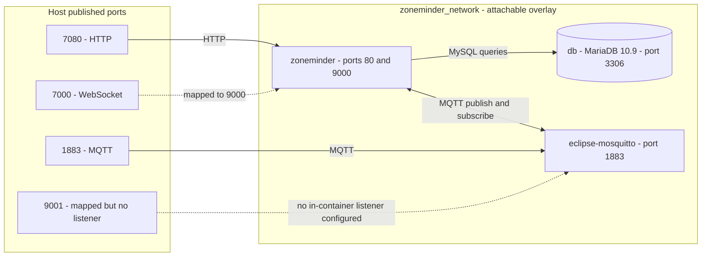

# System Overview

This document describes the high-level architecture of the containerized ZoneMinder deployment consisting of three services orchestrated via Docker Compose: **MariaDB** (database), **ZoneMinder** (video surveillance application), and **Eclipse Mosquitto** (MQTT broker for event notifications).

The stack is defined across two Compose files:
- `docker-compose.yml` — base service definitions, environment, volumes, and the shared overlay network
- `docker-compose.override.yml` — build configuration and host port mappings for the ZoneMinder and Mosquitto services

`.github/dependabot.yml` schedules weekly `docker` ecosystem dependency updates for the root directory, which covers the base-image pins in both `Dockerfile` and `Dockerfile.mosquitto`.

---

## Service Topology



**Caption:** Service topology showing host port mappings, the shared overlay network, and inter-service communication paths. The dotted 9001 edge exists in the port mapping but the generated Mosquitto configuration declares no listener for it.

---

## Services

| Service | Image / Build | Internal Ports | Host Ports | Purpose |
|---------|---------------|----------------|------------|---------|
| `db` | `mariadb:10.9` | 3306 | — | Persistent relational database for ZoneMinder configuration, events, and metadata |
| `zoneminder` | `build: Dockerfile` (multi-stage) | 80 (HTTP), 9000 (WebSocket) | 7080 → 80, 7000 → 9000 | Video surveillance frontend, API, event processing, ML inference |
| `eclipse-mosquitto` | `build: Dockerfile.mosquitto` | 1883 (MQTT) | 1883 → 1883, 9001 → 9001 (no listener) | MQTT broker for real-time event notifications between ZoneMinder and external consumers |

### MariaDB (`db`)

- **Role**: Authoritative data store for ZoneMinder.
- **Configuration**: Database name, user, and passwords supplied via environment variables from `.env` (`MYSQL_DATABASE`, `MYSQL_USER`, `MYSQL_PASSWORD`, `MYSQL_ROOT_PASSWORD`).
- **Persistence**: Volume `db_data` mounted at `/var/lib/mysql`.
- **Network**: Attached to `zoneminder_network`; reachable at hostname `db` on port 3306.
- **Initialization**: The ZoneMinder entrypoint (`entrypoint.sh`) waits for MariaDB to accept connections, creates the schema via `zm_create.sql` on first run, and enables the `ZM_OPT_USE_EVENTNOTIFICATION` option.

### ZoneMinder (`zoneminder`)

- **Role**: Core surveillance application — camera management, recording, motion detection, event review, and ML-based object detection.
- **Build**: Multi-stage `Dockerfile` compiling OpenCV 4.6.0, installing the ZoneMinder ML API (`mlapi`), ZoneMinder 1.36 from the `iconnor` PPA, and `zmeventnotification` (Perl event server + hook scripts).
- **Configuration**: Entirely via environment variables mapped into `/etc/zm/zm.conf`, `/etc/zm/secrets.ini`, and `/etc/zm/zmeventnotification.ini` by the entrypoint script at container start.
- **Shared Memory**: `tmpfs` mount at `/dev/shm` (~400 MB) for high-performance frame passing between capture, analysis, and streaming components.
- **Persistence**: Named volumes for config (`zm_config`), cache (`zm_cache`), and face recognition datasets (`known_faces`, `unknown_faces`).
- **Network**: Attached to `zoneminder_network`; hostname `zoneminder`.
- **Ordering**: `docker-compose.yml` defines **no** `depends_on` for any service. Startup ordering is enforced only inside `entrypoint.sh`, which blocks on `netcat -z ${ZM_DB_HOST} 3306` until MariaDB accepts TCP connections. Mosquitto is not waited on; it must simply be up when the event notification system first publishes.

### Eclipse Mosquitto (`eclipse-mosquitto`)

- **Role**: Lightweight MQTT broker for the ZoneMinder event notification pipeline.
- **Build**: Thin wrapper (`Dockerfile.mosquitto`) around `eclipse-mosquitto:latest` that injects a custom entrypoint (`entrypoint_mosquitto.sh`).
- **Configuration**: Entrypoint generates `/mosquitto/config/mosquitto.conf` at startup with a single `listener 1883`, password authentication via `mosquitto_passwd` (`MQTT_USER`, `MQTT_PASSWORD` from `.env`), persistence enabled to `/mosquitto/data/`, and debug logging to stdout.
- **Persistence**: Volume `mosquitto_data` mounted at `/mosquitto/data` for message durability across restarts.
- **Network**: Attached to `zoneminder_network`; hostname `eclipse-mosquitto`.
- **Ports**: The override file maps host ports 1883 and 9001, but the generated `mosquitto.conf` declares **only** the 1883 listener — no WebSocket listener on 9001 is configured, so host connections to 9001 currently fail. Add a `listener 9001` (with `protocol websockets`) to `entrypoint_mosquitto.sh` to activate the mapping.

---

## Network Topology

### `zoneminder_network` (Overlay, Attachable)

```yaml
networks:
  zoneminder_network:
    driver: overlay
    attachable: true
```

- **Driver**: `overlay` — enables multi-host networking if the stack is deployed to a Swarm cluster; on a single host it behaves like a bridge with encrypted control plane.
- **Attachable**: `true` — allows standalone containers (e.g., debugging tools, external MQTT clients, backup jobs) to join the network via `docker network connect zoneminder_network <container>` without being part of the Compose project.
- **Service Discovery**: Docker's embedded DNS resolves service names (`db`, `zoneminder`, `eclipse-mosquitto`) to their container IPs within the network. The compose file hard-codes these service names into the ZoneMinder environment (`ZM_DB_HOST: db`, `MQTT_HOST: eclipse-mosquitto`, `ZM_SERVER_HOST: zoneminder`), so renaming a service requires updating those variables.
- **Isolation**: No ports are published by the base Compose file; only `docker-compose.override.yml` exposes ports to the host. This keeps inter-service traffic off the host network interface — MariaDB 3306 in particular is never reachable from outside the overlay.

### Communication Flows

| Direction | Protocol | Purpose |
|-----------|----------|---------|
| `zoneminder` → `db` | MySQL (3306) | Schema init, config, events, user auth |
| `zoneminder` (zmeventnotification) ↔ `eclipse-mosquitto` | MQTT (1883) | Publish alarm/event notifications; the event server also subscribes for hook processing |
| Host → `zoneminder` | HTTP (7080→80) | Web UI, REST API |
| Host → `zoneminder` | WebSocket (7000→9000) | Live view streams, event push (zmeventnotification WebSocket server) |
| Host → `eclipse-mosquitto` | MQTT (1883) | External consumers (Home Assistant, custom apps) |
| Host → `eclipse-mosquitto` | 9001 | Mapped in the override file, but no listener is configured in the generated broker config |

---

## Volume Topology

| Volume | Service(s) | Mount Point | Purpose |
|--------|------------|-------------|---------|
| `db_data` | `db` | `/var/lib/mysql` | MariaDB data directory (tables, indexes, logs) |
| `zm_config` | `zoneminder` | `/etc/zm` | ZoneMinder configuration files (zm.conf, secrets.ini, zmeventnotification.ini) |
| `zm_cache` | `zoneminder` | `/var/cache/zoneminder` | Cached images, thumbnails, temporary files |
| `known_faces` | `zoneminder` | `/var/lib/zmeventnotification/known_faces` | Face recognition reference images |
| `unknown_faces` | `zoneminder` | `/var/lib/zmeventnotification/unknown_faces` | Unrecognized face captures for review/training |
| `mosquitto_data` | `eclipse-mosquitto` | `/mosquitto/data` | MQTT message persistence (retained messages, subscriptions) |

All six volumes are **named Docker volumes** declared in the base compose file — there are no bind mounts. They survive `docker-compose down` and are not tied to the host filesystem, ensuring portability across hosts and backup via `docker volume` tooling.

Note that `zm_config` doubles as first-run seed state: the Dockerfile copies the image's pristine `/etc/zm` contents to `/org/etc/zm` at build time, and `entrypoint.sh` restores them into the (otherwise empty) `zm_config` volume on the first container start. Subsequent starts reuse whatever is in the volume, including any manual edits.

---

## Port Mapping Summary

| Host Port | Container | Container Port | Protocol | Notes |
|-----------|-----------|----------------|----------|-------|
| 7080 | `zoneminder` | 80 | HTTP | Web UI, REST API |
| 7000 | `zoneminder` | 9000 | WebSocket | zmeventnotification WebSocket listener |
| 1883 | `eclipse-mosquitto` | 1883 | MQTT | Native MQTT for external clients |
| 9001 | `eclipse-mosquitto` | 9001 | — | Mapped but the generated `mosquitto.conf` defines no listener; connections fail |

> **Note**: MariaDB port 3306 is **not** published to the host. Database access is restricted to the overlay network.

---

## Environment Configuration

All secrets and tunables are sourced from a `.env` file at the project root (not committed). Required variables:

```dotenv
MYSQL_ROOT_PASSWORD=<root_password>
MYSQL_DATABASE=<database_name>
MYSQL_USER=<database_user>
MYSQL_PASSWORD=<database_password>
TZ=Europe/Berlin
MQTT_USER=<mqtt_user>
MQTT_PASSWORD=<mqtt_password>
ZM_USER=<zm_username>
ZM_PASSWORD=<zm_password>
```

The entrypoint scripts (`entrypoint.sh`, `entrypoint_mosquitto.sh`) interpolate these into service configuration files at startup, enabling immutable images and environment-specific deployments. In addition, `docker-compose.yml` injects service-name wiring into the `zoneminder` container (`ZM_DB_HOST: db`, `MQTT_HOST: eclipse-mosquitto`, `ZM_SERVER_HOST: zoneminder`) and passes `MQTT_USER`/`MQTT_PASSWORD` to `eclipse-mosquitto`.

---

## Startup Order & Health

1. **MariaDB** and **Mosquitto** start concurrently — the compose file defines no `depends_on` anywhere, so all three containers launch in parallel.
2. The **ZoneMinder entrypoint** (`entrypoint.sh`) first seeds `/etc/zm` from `/org/etc/zm` if the config volume is empty, applies the `TZ` timezone/PHP settings, then blocks on `netcat -z ${ZM_DB_HOST} 3306` until MariaDB accepts connections.
3. On first run (the ZoneMinder database has zero tables), the entrypoint creates the database/user with root credentials and imports `/usr/share/zoneminder/db/zm_create.sql`; it then enables `ZM_OPT_USE_EVENTNOTIFICATION` unconditionally on every start.
4. The entrypoint rewrites `/etc/zm/zm.conf` with the DB connection values, configures the `[mqtt]` section of `zmeventnotification.ini` (enable, server, username, password, `retain = yes`; `[ssl]` disabled), and rewrites `secrets.ini` (portal URL to `http://zoneminder/`, `ZM_USER`/`ZM_PASSWORD`, a freshly generated `MLAPI_SECRET_KEY`).
5. Finally it starts `apache2` and `zoneminder` via `service`, and keeps the container alive with `tail -f /dev/null`.
6. **Healthcheck**: Only the ZoneMinder image defines a healthcheck — `HEALTHCHECK --interval=1m --timeout=10s --retries=3 CMD curl -f http://localhost/zm/ || exit 1`. Neither the compose files nor the repo's Dockerfiles add a healthcheck for `db` or `eclipse-mosquitto`, so those containers report no health status; liveness is only the process itself.

---

## Related Pages

- [Container Design](container-design.md) — Multi-stage Dockerfile internals, build pipeline, and image composition
- [Event Notifications](../integrations/event-notifications.md) — MQTT event flow, zmeventnotification configuration, and hook scripts
- [Database Integration](../integrations/database.md) — MariaDB schema initialization and data model
- [Entrypoint Flow](../operations/entrypoint-flow.md) — Step-by-step first-boot and restart behavior of `entrypoint.sh`
- [Deployment](../operations/deployment.md) — Operational procedures: bring-up, backup, restore, upgrade
- [Quickstart](../quickstart.md) — Getting the stack running end to end
