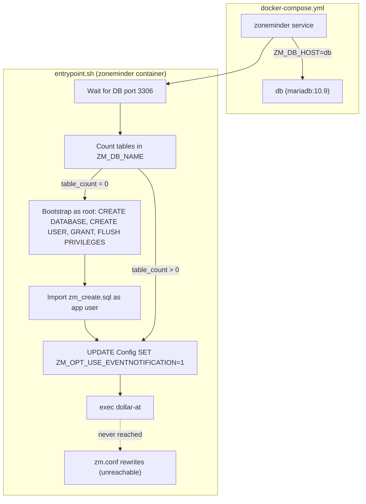

# Database Integration

This page describes how the ZoneMinder container provisions, connects to, and configures its MariaDB backend. All database logic lives in the container's `entrypoint.sh`; the wiring of credentials and hostnames is driven by environment variables in `docker-compose.yml`. For a phase-by-phase trace of the whole startup script, see [Entrypoint Flow](../operations/entrypoint-flow.md).

## Architecture Overview



**Caption:** Database provisioning and connection flow; the `zm.conf` rewrites sit after `exec "$@"` and never execute.

## Credentials & User Separation

Two distinct database identities are used:

| Role | Username | Password Source | Purpose |
|------|----------|-----------------|---------|
| **Root** | `root` | `MYSQL_ROOT_PASSWORD` | One-time bootstrap: `CREATE DATABASE`, `CREATE USER`, `GRANT ALL PRIVILEGES`, `FLUSH PRIVILEGES` |
| **App** | `ZM_DB_USER` | `ZM_DB_PASS` (== `MYSQL_PASSWORD`) | Table-count check, schema import, `UPDATE Config`, and all runtime queries |

The `docker-compose.yml` maps the same `.env` secret to both `MYSQL_PASSWORD` (the MariaDB container's app-user password) and `ZM_DB_PASS` (the ZoneMinder container's app-user password), so the app user's password is identical on both sides of the connection. `ZM_DB_HOST` is hard-coded to the literal service name `db` rather than sourced from `.env`.

## Credential Coupling

| Compose mapping | Value | Effect |
|-----------------|-------|--------|
| `MYSQL_PASSWORD: ${MYSQL_PASSWORD}` | `db` service env | MariaDB's `MYSQL_USER` account is created with this password |
| `ZM_DB_PASS: ${MYSQL_PASSWORD}` | `zoneminder` service env | `entrypoint.sh` connects with the same password as `ZM_DB_USER` |
| `ZM_DB_USER: ${MYSQL_USER}` | `zoneminder` service env | Same username MariaDB created via `MYSQL_USER` |
| `ZM_DB_HOST: db` | literal `db` | Hard-codes the compose service name; renaming the service breaks the entrypoint |

Because these four variables are coupled, the app identity works out of the box on first run. If any one of them is changed independently (for example, rotating `ZM_DB_PASS` without recreating the `db_data` volume), authentication fails — see [Troubleshooting](../operations/troubleshooting.md).

## Bootstrap Sequence (First Run)

1. **Wait for MariaDB** – `netcat -z ${ZM_DB_HOST} 3306` loops until the DB port accepts connections (1-second sleep between attempts).
2. **Table-count check** – run as the app user:
   ```sql
   SELECT COUNT(*) FROM information_schema.tables WHERE table_schema = '$ZM_DB_NAME';
   ```
   - If **> 0 tables**: assume schema already exists; skip bootstrap entirely.
   - If **0 tables**: proceed to bootstrap.
3. **Root-privileged provisioning** (single `mysql` invocation as MySQL `root`):
   ```sql
   CREATE DATABASE IF NOT EXISTS ${ZM_DB_NAME};
   CREATE USER IF NOT EXISTS '${ZM_DB_USER}'@'%' IDENTIFIED BY '${ZM_DB_PASS}';
   GRANT ALL PRIVILEGES ON ${ZM_DB_NAME}.* TO '${ZM_DB_USER}'@'%';
   FLUSH PRIVILEGES;
   ```
   This requires `MYSQL_ROOT_PASSWORD`, which is also passed to the ZoneMinder container solely for this step.
4. **Schema import** – As the app user:
   ```bash
   mysql -u ${ZM_DB_USER} -p${ZM_DB_PASS} -h ${ZM_DB_HOST} ${ZM_DB_NAME} < /usr/share/zoneminder/db/zm_create.sql
   ```
   The `zm_create.sql` file is installed by the `zoneminder` Debian package (from the `ppa:iconnor/zoneminder-1.36` repository in the Dockerfile) into `/usr/share/zoneminder/db/`.
5. **Enable Event Notification** – Always run as the app user, whether or not bootstrap ran:
   ```sql
   UPDATE Config SET Value = '1' WHERE Name = 'ZM_OPT_USE_EVENTNOTIFICATION';
   ```
   This toggle activates the event notification pathway used by the ML/AI hook pipeline (see [Event Notifications](event-notifications.md) if present, or [Entrypoint Flow](../operations/entrypoint-flow.md)).

> **Entrypoint quirk — `zm.conf` rewrites are unreachable:** The four `sed` commands that rewrite `ZM_DB_HOST`, `ZM_DB_USER`, `ZM_DB_PASS`, and `ZM_DB_NAME` into `/etc/zm/zm.conf` are placed **after** `exec "$@"` in `entrypoint.sh`. Once `exec` replaces the shell process, the subsequent lines never run. In practice, `/etc/zm/zm.conf` keeps whatever values were seeded from `/org/etc/zm` on first run (the image's pristine backup). Any manual edit to `zm.conf` must be made by mounting it or modifying the seeded file — the entrypoint will not update it. This mirrors the full trace in [Entrypoint Flow](../operations/entrypoint-flow.md), Phase 6.

## Environment Variables

| Variable | Source | Consumed By | Notes |
|----------|--------|-------------|-------|
| `MYSQL_ROOT_PASSWORD` | `.env` / shell | `db` service, `entrypoint.sh` (root bootstrap) | Root password for MariaDB container; also injected into the `zoneminder` service for the one-time `CREATE DATABASE/USER` step |
| `MYSQL_DATABASE` | `.env` | `db` service (creates DB), `ZM_DB_NAME` | Default DB name |
| `MYSQL_USER` | `.env` | `db` service (creates user), `ZM_DB_USER` | App username |
| `MYSQL_PASSWORD` | `.env` | `db` service (sets user password), `ZM_DB_PASS` | App password — the shared secret that couples both services |
| `ZM_DB_HOST` | `docker-compose.yml` (hard-coded `db`) | `entrypoint.sh`, (intended) `zm.conf` | Service name of the MariaDB container |
| `ZM_DB_NAME` | `docker-compose.yml` (`${MYSQL_DATABASE}`) | `entrypoint.sh` | |
| `ZM_DB_USER` | `docker-compose.yml` (`${MYSQL_USER}`) | `entrypoint.sh` | |
| `ZM_DB_PASS` | `docker-compose.yml` (`${MYSQL_PASSWORD}`) | `entrypoint.sh` | |

## Configuration Toggle: `ZM_OPT_USE_EVENTNOTIFICATION`

The `Config` table row `ZM_OPT_USE_EVENTNOTIFICATION` is forced to `'1'` on every container start (bootstrap or not), via a direct `UPDATE Config` statement as the app user. This enables the **Event Notification Server** (`zmeventnotification.pl`) which:

- Receives alarm/event hooks from ZoneMinder
- Publishes to MQTT (Mosquitto) for external consumers
- Invokes the ML API (`mlapi.py`) for object/face recognition

If you disable this flag manually in the DB, the hook pipeline will not fire on the next event.

## Failure Modes & Invariants

| Scenario | Behavior |
|----------|----------|
| MariaDB not yet listening | `entrypoint.sh` blocks in `until netcat …` loop (1-second intervals) |
| `zm_create.sql` missing | `mysql … < …` fails → bootstrap aborts (no fallback) |
| `ZM_OPT_USE_EVENTNOTIFICATION` update fails | Silent failure (no `|| exit` guard); hook pipeline may be disabled |
| Schema already exists but corrupted | Table-count > 0 → bootstrap skipped → runtime errors likely |
| Root password mismatch | `CREATE DATABASE/USER/GRANT` fails → bootstrap aborts |
| Credential drift (`ZM_DB_PASS` ≠ MariaDB's stored password) | Table-count query fails with access-denied → bootstrap loop breaks |

## Operational Notes

- **Idempotency**: The `CREATE DATABASE IF NOT EXISTS` / `CREATE USER IF NOT EXISTS` / `GRANT` statements are safe to re-run, but the table-count guard prevents re-importing `zm_create.sql` once any table exists.
- **Secrets rotation**: Changing `MYSQL_PASSWORD`/`MYSQL_ROOT_PASSWORD` in `.env` requires recreating the `db_data` volume or manually rotating passwords inside MariaDB; the entrypoint does not handle credential rotation, and the unreachable `zm.conf` rewrites (see the quirk above) mean the runtime config file never tracks env changes.
- **Healthcheck**: The image's `HEALTHCHECK` (in `Dockerfile`) probes `http://localhost/zm/`; it does **not** verify DB connectivity directly.
- **Timezone**: `TZ` is propagated to PHP via `php.ini` edits in `entrypoint.sh` so timestamps in the DB match the host.

## Related Pages

- [System Overview](../architecture/system-overview.md) – Container topology and data flows
- [Deployment](../operations/deployment.md) – `.env` schema and compose commands
- [Entrypoint Flow](../operations/entrypoint-flow.md) – Full startup sequence including MQTT/ML wiring
- [Troubleshooting](../operations/troubleshooting.md) – Common DB connection and schema issues
