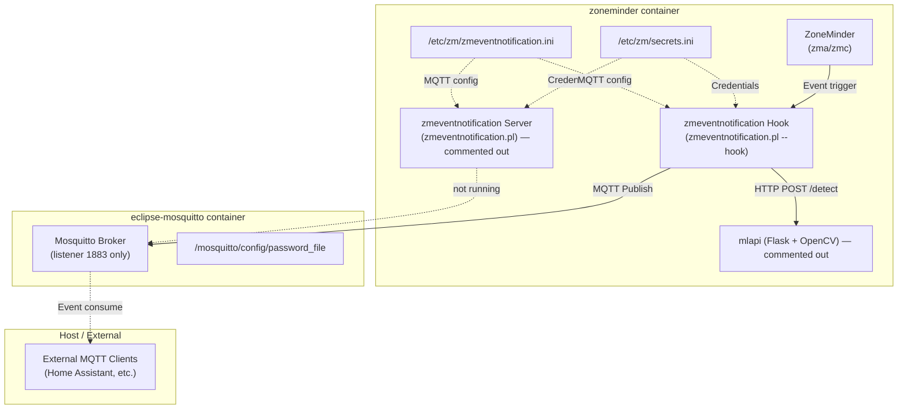
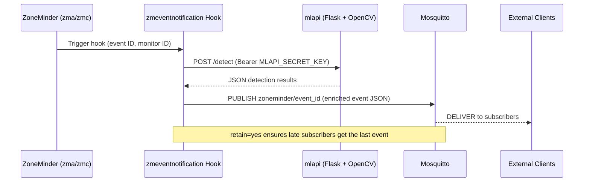

# Event Notifications & MQTT

This document describes the **zmeventnotification** integration with ZoneMinder, the MQTT broker (Eclipse Mosquitto) configuration, the runtime rewriting of `secrets.ini` and `zmeventnotification.ini`, the end-to-end event hook flow, and the MQTT topic model consumed by external clients.

> **Headline:** the full notification pipeline is *configured* by the entrypoints but only *partly launched*. The event notification server daemon (`zmeventnotification.pl`) is **not started** — its launch lines in `entrypoint.sh` are commented out — while the Mosquitto broker runs but only exposes the native MQTT listener. Out of the box, credentials and topics are prepared; the daemon that publishes them is not.

## Architecture Overview



**Caption:** Event notification pipeline showing ZoneMinder, the hook/server scripts, MQTT broker, and configuration files. Dotted edges are components the entrypoint configures but does not start.

---

## Component Responsibilities

| Component | Role | Location |
|-----------|------|----------|
| **zmeventnotification Server** (`zmeventnotification.pl`) | Long-running Perl daemon that listens for ZoneMinder events and publishes to MQTT; also provides a WebSocket API for live event streaming. **Installed but not launched** (see [below](#services-not-started-by-the-entrypoint)) | `/opt/zmeventnotification/` |
| **zmeventnotification Hook** (`zmeventnotification.pl --hook`) | Short-lived Perl script invoked by ZoneMinder's `zmtrigger.pl` on each alarm/event; calls mlapi for object/face detection, then publishes the enriched event to MQTT | `/opt/zmeventnotification/` |
| **Eclipse Mosquitto** | MQTT broker with password authentication and persistence, built from `eclipse-mosquitto:latest` via `Dockerfile.mosquitto` | `eclipse-mosquitto` container |
| **secrets.ini** | Runtime-injected credentials for the ZoneMinder web portal, the mlapi secret key, and API access | `/etc/zm/secrets.ini` |
| **zmeventnotification.ini** | Main configuration for the event notification server and hook; the `[mqtt]` section is enabled/configured at container startup by `entrypoint.sh` | `/etc/zm/zmeventnotification.ini` |

---

## MQTT Broker Configuration

### Mosquitto Container Build

The broker is a thin wrapper around `eclipse-mosquitto:latest` defined in `Dockerfile.mosquitto`:

```dockerfile
FROM eclipse-mosquitto:latest
COPY entrypoint_mosquitto.sh /entrypoint.sh
RUN chmod +x /entrypoint.sh
ENTRYPOINT [ "/entrypoint.sh" ]
```

No broker configuration is baked into the image — it is generated at every container start by the entrypoint script.

### Mosquitto Entrypoint (`entrypoint_mosquitto.sh`)

Generates the Mosquitto configuration and password file at startup:

```bash
mkdir -p /mosquitto/config

cat <<EOF > /mosquitto/config/mosquitto.conf
listener 1883
password_file /mosquitto/config/password_file
persistence true
persistence_location /mosquitto/data/
log_type all
log_type debug
log_dest stdout
EOF

touch /mosquitto/config/password_file
mosquitto_passwd -b /mosquitto/config/password_file $MQTT_USER $MQTT_PASSWORD
/usr/sbin/mosquitto -c /mosquitto/config/mosquitto.conf
```

**Key points:**

- **Authentication**: The password file is populated via `mosquitto_passwd -b` from the `MQTT_USER` / `MQTT_PASSWORD` environment variables (sourced from `.env` via `docker-compose.yml`). Both are required — without them, no client can authenticate.
- **Persistence**: Enabled with the data directory at `/mosquitto/data/`, backed by the `mosquitto_data` named volume.
- **Logging**: Debug-level logging sent to stdout for container log aggregation.
- **Listeners**: The generated `mosquitto.conf` defines **only `listener 1883`** — there is no WebSocket listener (see the [9001 gap](#the-9001-websocket-gap) below).
- The broker starts in the foreground as the container's main process, so its stdout is the container log.

### Docker Compose Service Definition

```yaml
eclipse-mosquitto:
  hostname: eclipse-mosquitto
  environment:
    MQTT_USER: ${MQTT_USER}
    MQTT_PASSWORD: ${MQTT_PASSWORD}
  networks:
    - zoneminder_network
  volumes:
    - mosquitto_data:/mosquitto/data
```

The hostname `eclipse-mosquitto` is what the ZoneMinder container uses as its `MQTT_HOST`.

### Host Port Mappings (`docker-compose.override.yml`)

```yaml
eclipse-mosquitto:
  build:
    context: .
    dockerfile: Dockerfile.mosquitto
  ports:
    - 1883:1883
    - 9001:9001
```

Only `1883:1883` is actually served: the generated configuration declares a single `listener 1883`, so host connections to port 9001 currently fail. To activate the WebSocket mapping, add a `listener 9001` block with `protocol websockets` to the heredoc in `entrypoint_mosquitto.sh` (there is no baked-in config to modify — the heredoc is the single source of broker settings).

---

## zmeventnotification.ini MQTT Section Enablement

The ZoneMinder container's `entrypoint.sh` **programmatically enables and configures the `[mqtt]` section** of `/etc/zm/zmeventnotification.ini` at startup using `sed` commands. This occurs only when `MQTT_HOST` is defined (i.e., the Mosquitto service is wired into the environment).

### Entrypoint Logic

```bash
if [ -e "/etc/zm/zmeventnotification.ini" ]; then
  # is mosquitto installed?
  if [ -n "$MQTT_HOST" ]; then
    sed -i "/\[mqtt\]/,/^\[/ s/^#*\s*enable\s*=.*/enable = yes/" /etc/zm/zmeventnotification.ini
    sed -i "/\[mqtt\]/,/^\[/ s/^#*\s*server\s*=.*/server = $MQTT_HOST/" /etc/zm/zmeventnotification.ini
    sed -i "/\[mqtt\]/,/^\[/ s/^#*\s*username\s*=.*/username = $MQTT_USER/" /etc/zm/zmeventnotification.ini
    sed -i "/\[mqtt\]/,/^\[/ s/^#*\s*password\s*=.*/password = $MQTT_PASSWORD/" /etc/zm/zmeventnotification.ini
    sed -i "/\[mqtt\]/,/^\[/ s/^#*\s*retain\s*=.*/retain = yes/" /etc/zm/zmeventnotification.ini
    sed -i "/\[ssl\]/,/^\[/ s/^#*\s*enable\s*=.*/enable = no/" /etc/zm/zmeventnotification.ini
  fi
```

### Sed Pattern Breakdown

| Command | Pattern | Effect |
|---------|---------|--------|
| `enable` | `/\[mqtt\]/,/^\[/ s/^#*\s*enable\s*=.*/enable = yes/` | Uncomments and sets `enable = yes` in the `[mqtt]` section |
| `server` | `/\[mqtt\]/,/^\[/ s/^#*\s*server\s*=.*/server = $MQTT_HOST/` | Sets MQTT broker hostname (e.g., `eclipse-mosquitto`) |
| `username` | `/\[mqtt\]/,/^\[/ s/^#*\s*username\s*=.*/username = $MQTT_USER/` | Sets MQTT username from environment |
| `password` | `/\[mqtt\]/,/^\[/ s/^#*\s*password\s*=.*/password = $MQTT_PASSWORD/` | Sets MQTT password from environment |
| `retain` | `/\[mqtt\]/,/^\[/ s/^#*\s*retain\s*=.*/retain = yes/` | Enables retained messages for late-joining subscribers |
| `ssl enable` | `/\[ssl\]/,/^\[/ s/^#*\s*enable\s*=.*/enable = no/` | Disables SSL/TLS for local network communication |

**Range operator `/\[mqtt\]/,/^\[/`** — matches from the `[mqtt]` header to the next section header, ensuring only the MQTT section is modified. The same technique is used for the `[ssl]` section.

**Conditions:** The rewrite only happens if `/etc/zm/zmeventnotification.ini` exists (i.e., the `zm_config` volume was seeded on first run) **and** `MQTT_HOST` is non-empty. In `docker-compose.yml` `MQTT_HOST: eclipse-mosquitto` is hard-coded, so both conditions hold in the standard deployment.

---

## secrets.ini Portal URL Rewrite & Credential Injection

Inside the same `zmeventnotification.ini` guard block, `entrypoint.sh` rewrites `/etc/zm/secrets.ini` to:

1. Replace the placeholder portal URL with the internal ZoneMinder hostname
2. Inject ZoneMinder admin credentials
3. Generate a fresh `MLAPI_SECRET_KEY`

### Entrypoint Logic

```bash
# adjust the secrets.ini
sed -i 's|https://portal/|http://zoneminder/|g' /etc/zm/secrets.ini
sed -i "s/^ZM_USER=.*/ZM_USER=${ZM_USER}/" /etc/zm/secrets.ini
sed -i "s/^ZM_PASSWORD=.*/ZM_PASSWORD=${ZM_PASSWORD}/" /etc/zm/secrets.ini
SECRET_KEY=$(openssl rand -base64 32)
if grep -q 'MLAPI_SECRET_KEY' /etc/zm/secrets.ini; then
  sed -i "s/^MLAPI_SECRET_KEY=.*/MLAPI_SECRET_KEY=${SECRET_KEY}/" /etc/zm/secrets.ini
else
  echo "MLAPI_SECRET_KEY=${SECRET_KEY}" >> /etc/zm/secrets.ini
fi
```

### Transformations

| Operation | Before | After |
|-----------|--------|-------|
| Portal URL | `https://portal/` | `http://zoneminder/` |
| `ZM_USER` | placeholder or empty | `${ZM_USER}` from environment (typically `admin`) |
| `ZM_PASSWORD` | placeholder or empty | `${ZM_PASSWORD}` from environment |
| `MLAPI_SECRET_KEY` | existing value or absent | New 32-byte base64 key (regenerated on **every container start**) |

### Purpose of Each Field

| Field | Used By | Purpose |
|-------|---------|---------|
| `ZM_USER` / `ZM_PASSWORD` | zmeventnotification hook & server | Authenticate to the ZoneMinder web portal/API for event metadata, alarm frames, and monitor info |
| `MLAPI_SECRET_KEY` | zmeventnotification hook ↔ mlapi | Bearer token for the `Authorization: Bearer <key>` header on mlapi endpoints (`/detect`, `/train`) |
| Portal URL | zmeventnotification hook | Base URL for constructing API paths (e.g., `http://zoneminder/zm/api/...`) |

**Security notes:**

- `MLAPI_SECRET_KEY` rotates on every container restart. If mlapi runs in a separate container, you must either share the `zm_config` volume or pin the key via `.env` and modify the entrypoint to stop regenerating it.
- MQTT credentials are written **in cleartext** into the volume-persisted `zmeventnotification.ini`, and the Mosquitto password file is rebuilt from the same environment variables on every broker start — keep both containers reading the same `.env` or authentication fails.

---

## MQTT Topic Flow for Events

### Topic Structure

The zmeventnotification hook and server publish to topics following this pattern:

```
zoneminder/<event_id>
```

Where `<event_id>` is the ZoneMinder event ID (numeric). External clients subscribe to the wildcard `zoneminder/#` to observe all events.

### Message Payload

The hook publishes a JSON payload containing the event context enriched with ML detection results:

```json
{
  "event_id": 12345,
  "monitor_id": 2,
  "monitor_name": "Front Door",
  "cause": "Motion",
  "start_time": "2024-01-15 10:30:45",
  "end_time": "2024-01-15 10:31:12",
  "duration": 27,
  "alarm_frames": 15,
  "total_frames": 120,
  "detection": {
    "objects": [
      {"label": "person", "confidence": 0.92, "box": [100, 200, 300, 400]},
      {"label": "car", "confidence": 0.78, "box": [400, 150, 600, 350]}
    ],
    "faces": [
      {"name": "John", "confidence": 0.88, "box": [120, 210, 180, 280]}
    ]
  },
  "snapshot_url": "http://zoneminder/zm/index.php?view=image&eid=12345&fid=alm",
  "video_url": "http://zoneminder/zm/index.php?view=watch&eid=12345"
}
```

*(Illustrative shape — the exact fields follow the upstream zmeventnotification hook contract plus mlapi detection results.)*

### Sequence Diagram



**Caption:** End-to-end event flow from ZoneMinder trigger through hook and mlapi to MQTT publication. The mlapi leg requires mlapi to be running (see the note on services not started).

### Retained Messages

The `retain = yes` setting in `zmeventnotification.ini` causes Mosquitto to store the **last message per topic**. This means:

- New MQTT subscribers (e.g., Home Assistant on restart) immediately receive the latest event state for each `zoneminder/<eid>` topic
- Only the most recent event per event-ID is retained (since event IDs are unique, this effectively retains the last event overall)

Retained messages are also persisted to the `mosquitto_data` volume via `persistence true`, so they survive broker restarts — not just subscriber reconnects.

### External Client Consumption

External clients connect to the broker on host port `1883` (published by `docker-compose.override.yml`) and authenticate with the same `MQTT_USER` / `MQTT_PASSWORD` the ZoneMinder container uses. Typical consumers:

- **Home Assistant** or other automation platforms subscribing to `zoneminder/#`
- Custom notifiers (Pushover, Telegram bots, etc.)
- Dashboard applications reading the enriched detection payloads

Because the topic namespace is flat (`zoneminder/<event_id>`), consumers can subscribe broadly with `zoneminder/#` or narrowly to a specific event. Retained messages make new subscribers immediately current.

### The 9001 WebSocket Gap

`docker-compose.override.yml` maps host port `9001` to container port `9001` on the broker, but the generated `mosquitto.conf` only defines `listener 1883` — **no WebSocket listener is configured on 9001**. Browser-based MQTT dashboards that rely on MQTT-over-WebSocket therefore cannot connect as shipped. To close the gap, add to the heredoc in `entrypoint_mosquitto.sh`:

```
listener 9001
protocol websockets
```

Until that change is made, treat the 9001 mapping as inert.

---

## Services Not Started by the Entrypoint

`entrypoint.sh` performs all the *configuration* for the event notification system but deliberately does **not** start its daemon. Inside the `zmeventnotification.ini` guard block, the launch lines are commented out:

```bash
# Start the event notification server
#cd /opt/zmeventnotification
#./zmeventnotification.pl --debug --config /etc/zm/zmeventnotification.ini
```

The same applies to mlapi earlier in the script (`#python3 /usr/src/app/mlapi/mlapi.py -c mlapiconfig.ini`). What the entrypoint actually starts after the config rewrites is only Apache and the ZoneMinder service:

```bash
service apache2 start
service zoneminder start
tail -f /dev/null
```

**Operational consequence:** out of the box, the broker runs and publishes nothing, because neither the publishing daemon (`zmeventnotification.pl`) nor the ML inference service (mlapi) is running. ZoneMinder events fire and are recorded, and the hook may still be invoked by ZoneMinder's event subsystem (the DB flag `ZM_OPT_USE_EVENTNOTIFICATION` is forced to `1` on every start — see [Database Integration](./database.md)), but the WebSocket push server and its persistent MQTT connection to the broker are absent. To run the full pipeline, either:

1. Uncomment the two launch lines (or run them under a supervisor such as supervisord), or
2. Execute `zmeventnotification.pl` and `mlapi.py` manually inside the container, or
3. Run mlapi as a sidecar container — sharing `zm_config` or pinning `MLAPI_SECRET_KEY` so hook↔mlapi authentication survives key rotation.

The install.sh from the upstream zmeventnotification repository sets up systemd-style service files, but this container has no systemd init — that is why the entrypoint would have to launch the daemon directly, and currently does not.

---

## Configuration Summary

### Environment Variables (from `.env` / `docker-compose.yml`)

| Variable | Used In | Description |
|----------|---------|-------------|
| `MQTT_USER` | `entrypoint_mosquitto.sh`, `entrypoint.sh` | MQTT broker username |
| `MQTT_PASSWORD` | `entrypoint_mosquitto.sh`, `entrypoint.sh` | MQTT broker password |
| `MQTT_HOST` | `entrypoint.sh` | Broker hostname (`eclipse-mosquitto`) — presence triggers the MQTT config rewrite |
| `ZM_USER` | `entrypoint.sh` → `secrets.ini` | ZoneMinder admin username |
| `ZM_PASSWORD` | `entrypoint.sh` → `secrets.ini` | ZoneMinder admin password |
| `TZ` | `entrypoint.sh` | Timezone for PHP and system |

### Volumes

| Volume | Mount Point | Purpose |
|--------|-------------|---------|
| `mosquitto_data` | `/mosquitto/data` | Mosquitto message persistence (retained messages, subscriptions) |
| `zm_config` | `/etc/zm` | Shared config volume (secrets.ini, zmeventnotification.ini, zm.conf) |
| `known_faces` | `/var/lib/zmeventnotification/known_faces` | Face recognition reference images |
| `unknown_faces` | `/var/lib/zmeventnotification/unknown_faces` | Unrecognized face crops for review |

### Network

All services share the `zoneminder_network` overlay network (attachable). ZoneMinder reaches Mosquitto at the hostname `eclipse-mosquitto` on port 1883. The compose file defines no `depends_on`, so Mosquitto is not waited on — it must be up when the notification system first publishes, which is normally the case since both entrypoints complete their setup quickly.

---

## Operational Notes

1. **MQTT config is runtime-generated** — The `zmeventnotification.ini` file in the image is a template; the `[mqtt]` section is activated and populated by `entrypoint.sh` on every container start. Changes to `MQTT_*` env vars require a ZoneMinder container restart to take effect.

2. **Secrets rotate on restart** — `MLAPI_SECRET_KEY` is regenerated each start. If you need a static key (e.g., for an external mlapi), set `MLAPI_SECRET_KEY` in `.env` and modify `entrypoint.sh` to skip generation.

3. **Portal URL rewrite assumes internal hostname** — The `sed` replaces `https://portal/` with `http://zoneminder/`. If you rename the ZoneMinder service in `docker-compose.yml`, update the replacement target accordingly.

4. **SSL disabled for local MQTT** — The entrypoint forces `ssl enable = no` in `zmeventnotification.ini`. For deployments crossing network boundaries, enable TLS in both Mosquitto (add a `listener 8883` with certs to the heredoc in `entrypoint_mosquitto.sh`) and `zmeventnotification.ini` (`ssl enable = yes`, `cafile`, `certfile`, `keyfile`).

5. **Server not running** — The most common reason "events are configured but MQTT is silent" is that `zmeventnotification.pl` is not started (see [Services Not Started](#services-not-started-by-the-entrypoint)). Verify with `ps aux` inside the container before debugging broker connectivity.

6. **Hook vs Server roles** — The hook (per-event) and server (daemon) have distinct publish roles: the hook publishes enriched detection results, the server publishes event state transitions (start, end, alarm) and drives WebSocket push. Consumers should handle both message kinds; today only the hook path can run, and only if mlapi is reachable.

---

## Related Pages

- [System Overview](../architecture/system-overview.md) — Service topology and network/volume layout
- [ML/AI Pipeline](../architecture/ml-pipeline.md) — Object detection and face recognition flow (hook → mlapi → MQTT)
- [Database Integration](./database.md) — MariaDB bootstrap and `ZM_OPT_USE_EVENTNOTIFICATION` toggle
- [Entrypoint Flow](../operations/entrypoint-flow.md) — Full container startup sequence including MQTT/ML wiring
- [Troubleshooting](../operations/troubleshooting.md) — MQTT authentication, hook, and `MLAPI_SECRET_KEY` diagnostics
