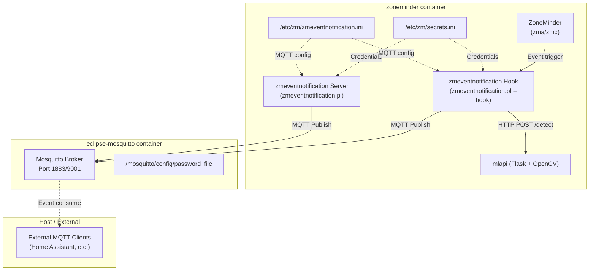
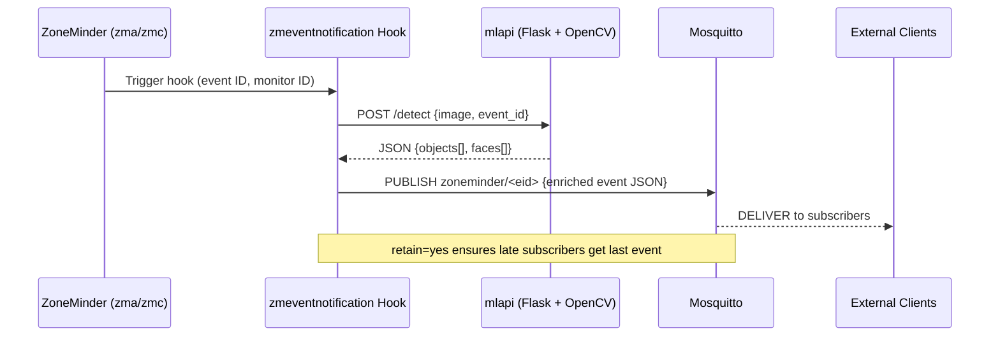

# Event Notifications & MQTT

This document describes the **zmeventnotification** integration with ZoneMinder, the MQTT broker (Eclipse Mosquitto) configuration, the runtime rewriting of `secrets.ini` and `zmeventnotification.ini`, and the end-to-end MQTT topic flow for event notifications.

## Architecture Overview



**Caption:** Event notification pipeline showing ZoneMinder, the hook/server scripts, MQTT broker, and configuration files.

---

## Component Responsibilities

| Component | Role | Location |
|-----------|------|----------|
| **zmeventnotification Server** (`zmeventnotification.pl`) | Long-running Perl daemon that listens for ZoneMinder events and publishes to MQTT; also provides WebSocket API for live event streaming | `/opt/zmeventnotification/` |
| **zmeventnotification Hook** (`zmeventnotification.pl --hook`) | Short-lived Perl script invoked by ZoneMinder's `zmtrigger.pl` on each alarm/event; calls mlapi for object/face detection, then publishes enriched event to MQTT | `/opt/zmeventnotification/` |
| **Eclipse Mosquitto** | MQTT broker with password authentication, persistence, and WebSocket support | `eclipse-mosquitto` container |
| **secrets.ini** | Runtime-injected credentials for ZoneMinder web portal, mlapi secret key, and database | `/etc/zm/secrets.ini` |
| **zmeventnotification.ini** | Main configuration for the event notification server and hook; MQTT section enabled/configured at container startup | `/etc/zm/zmeventnotification.ini` |

---

## MQTT Broker Configuration

### Mosquitto Container Build

The broker is a thin wrapper around `eclipse-mosquitto:latest` defined in `Dockerfile.mosquitto`:

```dockerfile
FROM eclipse-mosquitto:latest
COPY entrypoint_mosquitto.sh /entrypoint.sh
RUN chmod +x /entrypoint.sh
ENTRYPOINT [ "/entrypoint.sh" ]
```

### Mosquitto Entrypoint (`entrypoint_mosquitto.sh`)

Generates the Mosquitto configuration and password file at startup:

```bash
#!/bin/sh -x
mkdir -p /mosquitto/config

cat <<EOF > /mosquitto/config/mosquitto.conf
listener 1883
password_file /mosquitto/config/password_file
persistence true
persistence_location /mosquitto/data/
log_type all
log_type debug
log_dest stdout
EOF

touch /mosquitto/config/password_file
mosquitto_passwd -b /mosquitto/config/password_file $MQTT_USER $MQTT_PASSWORD
/usr/sbin/mosquitto -c /mosquitto/config/mosquitto.conf
```

**Key points:**
- **Authentication**: Password file created from `MQTT_USER` / `MQTT_PASSWORD` environment variables (sourced from `.env` via `docker-compose.yml`)
- **Persistence**: Enabled with data directory at `/mosquitto/data/` (backed by `mosquitto_data` volume)
- **Ports**: 1883 (native MQTT), 9001 (WebSocket) — both exposed to host in `docker-compose.override.yml`
- **Logging**: Debug-level to stdout for container log aggregation

### Docker Compose Service Definition

```yaml
eclipse-mosquitto:
  hostname: eclipse-mosquitto
  environment:
    MQTT_USER: ${MQTT_USER}
    MQTT_PASSWORD: ${MQTT_PASSWORD}
  networks:
    - zoneminder_network
  volumes:
    - mosquitto_data:/mosquitto/data
```

The hostname `eclipse-mosquitto` is used by the ZoneMinder container as `MQTT_HOST`.

---

## zmeventnotification.ini MQTT Section Enablement

The ZoneMinder container's `entrypoint.sh` **programmatically enables and configures the `[mqtt]` section** of `/etc/zm/zmeventnotification.ini` at startup using `sed` commands. This occurs only when `MQTT_HOST` is defined (i.e., the Mosquitto service is present).

### Entrypoint Logic (`entrypoint.sh` lines 101–113)

```bash
if [ -e "/etc/zm/zmeventnotification.ini" ]; then
  # is mosquitto installed?
  if [ -n "$MQTT_HOST" ]; then
    sed -i "/\[mqtt\]/,/^\[/ s/^#*\s*enable\s*=.*/enable = yes/" /etc/zm/zmeventnotification.ini
    sed -i "/\[mqtt\]/,/^\[/ s/^#*\s*server\s*=.*/server = $MQTT_HOST/" /etc/zm/zmeventnotification.ini
    sed -i "/\[mqtt\]/,/^\[/ s/^#*\s*username\s*=.*/username = $MQTT_USER/" /etc/zm/zmeventnotification.ini
    sed -i "/\[mqtt\]/,/^\[/ s/^#*\s*password\s*=.*/password = $MQTT_PASSWORD/" /etc/zm/zmeventnotification.ini
    sed -i "/\[mqtt\]/,/^\[/ s/^#*\s*retain\s*=.*/retain = yes/" /etc/zm/zmeventnotification.ini
    sed -i "/\[ssl\]/,/^\[/ s/^#*\s*enable\s*=.*/enable = no/" /etc/zm/zmeventnotification.ini
  fi
```

### Sed Pattern Breakdown

| Command | Pattern | Effect |
|---------|---------|--------|
| `enable` | `/\[mqtt\]/,/^\[/ s/^#*\s*enable\s*=.*/enable = yes/` | Uncomments and sets `enable = yes` in the `[mqtt]` section |
| `server` | `/\[mqtt\]/,/^\[/ s/^#*\s*server\s*=.*/server = $MQTT_HOST/` | Sets MQTT broker hostname (e.g., `eclipse-mosquitto`) |
| `username` | `/\[mqtt\]/,/^\[/ s/^#*\s*username\s*=.*/username = $MQTT_USER/` | Sets MQTT username from environment |
| `password` | `/\[mqtt\]/,/^\[/ s/^#*\s*password\s*=.*/password = $MQTT_PASSWORD/` | Sets MQTT password from environment |
| `retain` | `/\[mqtt\]/,/^\[/ s/^#*\s*retain\s*=.*/retain = yes/` | Enables retained messages for late-joining subscribers |
| `ssl enable` | `/\[ssl\]/,/^\[/ s/^#*\s*enable\s*=.*/enable = no/` | Disables SSL/TLS for local network communication |

**Range operator `/\[mqtt\]/,/^\[/`** — matches from the `[mqtt]` header to the next section header, ensuring only the MQTT section is modified.

---

## secrets.ini Portal URL Rewrite & Credential Injection

The same `entrypoint.sh` rewrites `/etc/zm/secrets.ini` to:
1. Replace the placeholder portal URL with the actual ZoneMinder hostname
2. Inject ZoneMinder admin credentials
3. Generate/rotate the `MLAPI_SECRET_KEY`

### Entrypoint Logic (`entrypoint.sh` lines 115–124)

```bash
# adjust the secrets.ini
sed -i 's|https://portal/|http://zoneminder/|g' /etc/zm/secrets.ini
sed -i "s/^ZM_USER=.*/ZM_USER=${ZM_USER}/" /etc/zm/secrets.ini
sed -i "s/^ZM_PASSWORD=.*/ZM_PASSWORD=${ZM_PASSWORD}/" /etc/zm/secrets.ini
SECRET_KEY=$(openssl rand -base64 32)
if grep -q 'MLAPI_SECRET_KEY' /etc/zm/secrets.ini; then
  sed -i "s/^MLAPI_SECRET_KEY=.*/MLAPI_SECRET_KEY=${SECRET_KEY}/" /etc/zm/secrets.ini
else
  echo "MLAPI_SECRET_KEY=${SECRET_KEY}" >> /etc/zm/secrets.ini
fi
```

### Transformations

| Operation | Before | After |
|-----------|--------|-------|
| Portal URL | `https://portal/` | `http://zoneminder/` |
| `ZM_USER` | placeholder or empty | `${ZM_USER}` from environment (default `admin`) |
| `ZM_PASSWORD` | placeholder or empty | `${ZM_PASSWORD}` from environment |
| `MLAPI_SECRET_KEY` | existing or absent | New 32-byte base64 key (regenerated on **every container start**) |

### Purpose of Each Field

| Field | Used By | Purpose |
|-------|---------|---------|
| `ZM_USER` / `ZM_PASSWORD` | zmeventnotification hook & server | Authenticate to ZoneMinder's REST API for event metadata, alarm frames, and monitor info |
| `MLAPI_SECRET_KEY` | zmeventnotification hook ↔ mlapi | Bearer token for `Authorization: Bearer <key>` header on `/detect`, `/train` endpoints |
| Portal URL | zmeventnotification hook | Base URL for constructing API paths (e.g., `http://zoneminder/zm/api/...`) |

**Security note:** `MLAPI_SECRET_KEY` rotates on every container restart. If `mlapi` runs in a separate container, you must either share the `zm_config` volume or pin the key via `.env` and modify the entrypoint to not regenerate it.

---

## MQTT Topic Flow for Events

### Topic Structure

The zmeventnotification hook and server publish to topics following this pattern:

```
zoneminder/<event_id>
```

Where `<event_id>` is the ZoneMinder event ID (numeric).

### Message Payload

The hook publishes a JSON payload containing:

```json
{
  "event_id": 12345,
  "monitor_id": 2,
  "monitor_name": "Front Door",
  "cause": "Motion",
  "start_time": "2024-01-15 10:30:45",
  "end_time": "2024-01-15 10:31:12",
  "duration": 27,
  "alarm_frames": 15,
  "total_frames": 120,
  "detection": {
    "objects": [
      {"label": "person", "confidence": 0.92, "box": [100, 200, 300, 400]},
      {"label": "car", "confidence": 0.78, "box": [400, 150, 600, 350]}
    ],
    "faces": [
      {"name": "John", "confidence": 0.88, "box": [120, 210, 180, 280]}
    ]
  },
  "snapshot_url": "http://zoneminder/zm/index.php?view=image&eid=12345&fid=alm",
  "video_url": "http://zoneminder/zm/index.php?view=watch&eid=12345"
}
```

### Sequence Diagram



### Retained Messages

The `retain = yes` setting in `zmeventnotification.ini` causes Mosquitto to store the **last message per topic**. This means:
- New MQTT subscribers (e.g., Home Assistant on restart) immediately receive the latest event state for each `zoneminder/<eid>` topic
- Only the most recent event per event-ID is retained (since event IDs are unique, this effectively retains the last event overall)

### WebSocket Access

External clients can also connect via MQTT over WebSocket on port **9001** (exposed as host port 9001 in `docker-compose.override.yml`), enabling browser-based dashboards.

---

## Configuration Summary

### Environment Variables (from `.env` / `docker-compose.yml`)

| Variable | Used In | Description |
|----------|---------|-------------|
| `MQTT_USER` | `entrypoint_mosquitto.sh`, `entrypoint.sh` | MQTT broker username |
| `MQTT_PASSWORD` | `entrypoint_mosquitto.sh`, `entrypoint.sh` | MQTT broker password |
| `MQTT_HOST` | `entrypoint.sh` | Broker hostname (`eclipse-mosquitto`) — triggers MQTT config |
| `ZM_USER` | `entrypoint.sh` → `secrets.ini` | ZoneMinder admin username |
| `ZM_PASSWORD` | `entrypoint.sh` → `secrets.ini` | ZoneMinder admin password |
| `TZ` | `entrypoint.sh` | Timezone for PHP and system |

### Volumes

| Volume | Mount Point | Purpose |
|--------|-------------|---------|
| `mosquitto_data` | `/mosquitto/data` | Mosquitto message persistence |
| `zm_config` | `/etc/zm` | Shared config (secrets.ini, zmeventnotification.ini, zm.conf) |
| `known_faces` | `/var/lib/zmeventnotification/known_faces` | Face recognition reference images |
| `unknown_faces` | `/var/lib/zmeventnotification/unknown_faces` | Unrecognized face crops for review |

### Network

All services share the `zoneminder_network` overlay network. ZoneMinder reaches Mosquitto at hostname `eclipse-mosquitto` (port 1883).

---

## Operational Notes

1. **MQTT config is runtime-generated** — The `zmeventnotification.ini` file in the image is a template; the `[mqtt]` section is activated and populated by `entrypoint.sh` on every container start. Changes to `MQTT_*` env vars require a ZoneMinder container restart.

2. **Secrets rotate on restart** — `MLAPI_SECRET_KEY` is regenerated each start. If you need a static key (e.g., for external mlapi), set `MLAPI_SECRET_KEY` in `.env` and modify `entrypoint.sh` to skip generation.

3. **Portal URL rewrite assumes internal hostname** — The `sed` replaces `https://portal/` with `http://zoneminder/`. If you change the ZoneMinder service name in `docker-compose.yml`, update the replacement target accordingly.

4. **SSL disabled for local MQTT** — The entrypoint forces `ssl enable = no` in `zmeventnotification.ini`. For production deployments crossing network boundaries, enable TLS in both Mosquitto (`listener 8883` + certs) and `zmeventnotification.ini` (`ssl enable = yes`, `cafile`, `certfile`, `keyfile`).

5. **Hook vs Server** — Both the hook (per-event) and the server (daemon) publish to MQTT. The hook publishes enriched detection results; the server publishes event state transitions (start, end, alarm). Consumers should handle both.

---

## Related Pages

- [System Overview](../architecture/system-overview.md) — Service topology and network/volume layout
- [ML/AI Pipeline](../architecture/ml-pipeline.md) — Object detection and face recognition flow
- [Database Integration](./database.md) — MariaDB bootstrap and `ZM_OPT_USE_EVENTNOTIFICATION` toggle
- [Entrypoint Flow](../operations/entrypoint-flow.md) — Full container startup sequence
