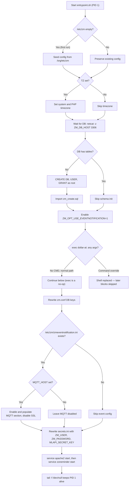
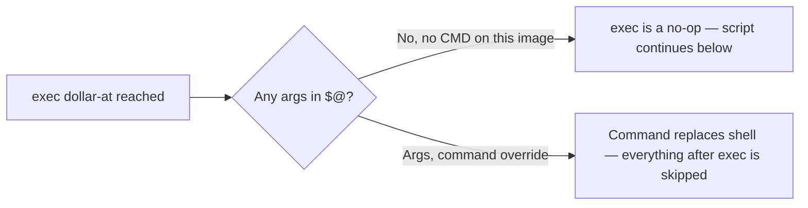

# Entrypoint Flow

<!-- openwiki: broken internal link [../Dockerfile] file "../Dockerfile" does not exist. Fix the href or restore the target, then delete this comment. -->
This document traces `/usr/local/bin/entrypoint.sh` line by line. The Dockerfile installs the script with `COPY entrypoint.sh /usr/local/bin/` and designates it as the container's `ENTRYPOINT` with **no `CMD`** ([repo://Dockerfile#L139-L155](../Dockerfile)). That combination — an entrypoint shell script plus an empty command line — is the key to understanding the `exec "$@"` handoff in the middle of the script (see [the boundary section](#the-exec--boundary--command-handoff-and-its-caveat)).

## Execution Overview



**Caption:** Entrypoint initialization sequence: config seeding, timezone, DB bootstrap, the `exec "$@"` handoff (a no-op in the normal path because the image declares no `CMD`), then config rewrites and service startup.

---

## Phase 1: Config Seeding (First-Run Initialization)

```bash
if [ -z "$(ls -A /etc/zm)" ]; then
   cp -R /org/etc/zm/* /etc/zm/
fi
```

<!-- openwiki: broken internal link [../Dockerfile] file "../Dockerfile" does not exist. Fix the href or restore the target, then delete this comment. -->
**Purpose**: On first container startup with a fresh `zm_config` volume, `/etc/zm` is empty. The script seeds it from the pristine backup at `/org/etc/zm`, which the Dockerfile populates at image build time (`RUN cp -R /etc/zm/* /org/etc/zm/` after all package installation and Apache configuration is complete — [repo://Dockerfile#L140-L143](../Dockerfile)).

**Behavior**:
- Runs only when `/etc/zm` contains zero entries (`ls -A` shows nothing).
- Preserves user customizations on subsequent starts — the `zm_config` volume already has files, so the guard skips the copy.
- Files seeded include `zm.conf`, `zmeventnotification.ini` (installed by zmeventnotification's `install.sh --install-config`), `secrets.ini`, and Apache/ZoneMinder configs under `conf.d/`.

<!-- openwiki: broken internal link [../entrypoint.sh] file "../entrypoint.sh" does not exist. Fix the href or restore the target, then delete this comment. -->
**Evidence**: [repo://entrypoint.sh#L8-L10](../entrypoint.sh)

---

## Phase 2: Timezone Configuration

```bash
if [ -n "$TZ" ]; then
    echo $TZ > /etc/timezone
    rm -rf /etc/localtime
    ln -s /usr/share/zoneinfo/$TZ /etc/localtime
    dpkg-reconfigure --frontend noninteractive tzdata

    find /etc -name "php.ini" | while read -r filepath
    do
        grep -q "^[;]*\s*date.timezone " "${filepath}"
        if [ $? -eq 0 ]; then
            sed -i "s|^[;]*\s*date.timezone .*|date.timezone = ${TZ}|g" "${filepath}"
        else
            echo "date.timezone = ${TZ}" >> "${filepath}"
        fi
    done
fi
```

<!-- openwiki: broken internal link [../docker-compose.yml] file "../docker-compose.yml" does not exist. Fix the href or restore the target, then delete this comment. -->
**Purpose**: Applies the `TZ` environment variable (e.g., `Europe/Berlin`, set on both the `db` and `zoneminder` services in [repo://docker-compose.yml](../docker-compose.yml)) to the system timezone and all PHP `php.ini` files.

**Details**:
1. Writes `$TZ` to `/etc/timezone`.
2. Replaces the `/etc/localtime` symlink to point at the correct zoneinfo file.
3. Runs `dpkg-reconfigure tzdata` non-interactively to update the system timezone data.
4. Finds every `php.ini` under `/etc` and ensures `date.timezone = $TZ` is set — uncommenting and rewriting an existing (possibly commented) entry, or appending one if missing.

**Required**: No — if `TZ` is unset, the block is skipped and the container defaults to UTC.

<!-- openwiki: broken internal link [../entrypoint.sh] file "../entrypoint.sh" does not exist. Fix the href or restore the target, then delete this comment. -->
**Evidence**: [repo://entrypoint.sh#L17-L37](../entrypoint.sh)

---

## Phase 3: Database Wait Loop (netcat)

```bash
until netcat -z ${ZM_DB_HOST} 3306; do
  echo "Waiting for MariaDB server to start..."
  sleep 1
done
```

<!-- openwiki: broken internal link [../docker-compose.yml] file "../docker-compose.yml" does not exist. Fix the href or restore the target, then delete this comment. -->
**Purpose**: Blocks until the MariaDB server (the `db` service — hostname `db` is hard-coded as `ZM_DB_HOST` in [repo://docker-compose.yml#L16-L17](../docker-compose.yml)) accepts TCP connections on port 3306.

**Mechanism**:
- `netcat -z` performs a zero-I/O TCP connection probe (no data sent).
- The loop sleeps 1 second between attempts and runs indefinitely until the DB is reachable.
<!-- openwiki: broken internal link [../Dockerfile] file "../Dockerfile" does not exist. Fix the href or restore the target, then delete this comment. -->
- The container image installs `netcat` specifically for this loop ([repo://Dockerfile#L66-L71](../Dockerfile)).

**Variables**: Requires `ZM_DB_HOST` (set to `db` by compose).

<!-- openwiki: broken internal link [../entrypoint.sh] file "../entrypoint.sh" does not exist. Fix the href or restore the target, then delete this comment. -->
**Evidence**: [repo://entrypoint.sh#L45-L48](../entrypoint.sh)

---

## Phase 4: Database Bootstrap & Table-Count Check

```bash
table_count=$(mysql -h "$ZM_DB_HOST" -u "$ZM_DB_USER" -p"$ZM_DB_PASS" -e "SELECT COUNT(*) FROM information_schema.tables WHERE table_schema = '$ZM_DB_NAME';" -s)

if [ "$table_count" -gt 0 ]; then
  echo "There are $table_count tables in the $ZM_DB_NAME database"
else
  echo "There are no tables in the $ZM_DB_NAME database"
  mysql -u root -p${MYSQL_ROOT_PASSWORD} -h ${ZM_DB_HOST} -e "CREATE DATABASE IF NOT EXISTS ${ZM_DB_NAME}; CREATE USER IF NOT EXISTS '${ZM_DB_USER}'@'%' IDENTIFIED BY '${ZM_DB_PASS}'; GRANT ALL PRIVILEGES ON ${ZM_DB_NAME}.* TO '${ZM_DB_USER}'@'%'; FLUSH PRIVILEGES;"
  mysql -u ${ZM_DB_USER} -p${ZM_DB_PASS} -h ${ZM_DB_HOST} ${ZM_DB_NAME} < /usr/share/zoneminder/db/zm_create.sql
fi
```

**Purpose**: Determines whether the ZoneMinder database schema already exists. If empty, creates the database, user, and grants, then imports the canonical schema.

**Logic**:
1. Queries `information_schema.tables` for the count of tables in `$ZM_DB_NAME` using the ZoneMinder DB user credentials.
2. **If tables exist (>0)**: Logs the count and skips initialization — the schema is assumed to be already provisioned (idempotent restarts).
3. **If empty (0)**:
<!-- openwiki: broken internal link [../docker-compose.yml] file "../docker-compose.yml" does not exist. Fix the href or restore the target, then delete this comment. -->
   - Connects as MySQL `root` (requires `MYSQL_ROOT_PASSWORD`, passed to the container by [repo://docker-compose.yml#L15-L24](../docker-compose.yml)) to create the database, create the user with host `%`, grant all privileges on the database, and flush privileges.
   - Imports `/usr/share/zoneminder/db/zm_create.sql` as the ZoneMinder user to populate tables.

**Variables required**: `ZM_DB_HOST`, `ZM_DB_NAME`, `ZM_DB_USER`, `ZM_DB_PASS` (table count + import), and `MYSQL_ROOT_PASSWORD` (root-level CREATE statements).

<!-- openwiki: broken internal link [../entrypoint.sh] file "../entrypoint.sh" does not exist. Fix the href or restore the target, then delete this comment. -->
**Evidence**: [repo://entrypoint.sh#L51-L64](../entrypoint.sh)

---

## Phase 5: Enable Event Notification Feature Flag

```bash
mysql -u ${ZM_DB_USER} -p${ZM_DB_PASS} -h ${ZM_DB_HOST} ${ZM_DB_NAME} -e \
"UPDATE Config SET Value = '1' WHERE Name = 'ZM_OPT_USE_EVENTNOTIFICATION';"
```

**Purpose**: Unconditionally sets the ZoneMinder option `ZM_OPT_USE_EVENTNOTIFICATION` to `1` in the `Config` table so ZoneMinder pushes events toward `zmeventnotification`. This runs on every startup, not just first initialization.

<!-- openwiki: broken internal link [../entrypoint.sh] file "../entrypoint.sh" does not exist. Fix the href or restore the target, then delete this comment. -->
**Evidence**: [repo://entrypoint.sh#L66-L68](../entrypoint.sh)

---

## The `exec "$@"` Boundary — Command Handoff and Its Caveat

```bash
# Execute the main ZoneMinder command
exec "$@"
```

<!-- openwiki: broken internal link [../entrypoint.sh] file "../entrypoint.sh" does not exist. Fix the href or restore the target, then delete this comment. -->
This line sits immediately after the event-notification UPDATE ([repo://entrypoint.sh#L66-L71](../entrypoint.sh)). Its effect depends entirely on what `$@` contains, which is determined by the Dockerfile:

```dockerfile
ENTRYPOINT ["entrypoint.sh"]
```

<!-- openwiki: broken internal link [../Dockerfile] file "../Dockerfile" does not exist. Fix the href or restore the target, then delete this comment. -->
The Dockerfile defines an `ENTRYPOINT` and **no `CMD`** ([repo://Dockerfile#L153-L155](../Dockerfile)), so Docker passes no arguments to the entrypoint and `"$@"` expands to **nothing**.

**Normal path — no command supplied**: In bash, `exec` with no command (and no redirection) is a **no-op**: it returns success and the shell simply continues with the next script line. So with this image's default configuration, `exec "$@"` does not terminate the script — execution falls through into the config rewrites (Phases 6–8) and service startup (Phase 9), which all run.

**Command override — arguments supplied**: If the container is started with a command override (`docker run image <command>`, `docker-compose run <service> <cmd>`, or an explicit `command:`), `$@` is non-empty and `exec` **replaces the running bash process** with that command. Control never returns to the entrypoint script, and **everything after this line is skipped**: the `zm.conf` rewrite, the MQTT/secrets.ini configuration, `service apache2 start`, `service zoneminder start`, and the `tail -f /dev/null` keep-alive. This is the caveat to keep in mind when using the entrypoint for one-off debugging shells — re-run the initialization steps manually or accept the services will not be running.



**Caption:** With no `CMD`, `exec "$@"` is a no-op and the remaining phases execute; a command override replaces the shell and makes every later block unreachable.

---

## Phase 6: Rewrite zm.conf with Runtime Credentials

```bash
sed -i "s/ZM_DB_HOST=.*/ZM_DB_HOST=$ZM_DB_HOST/" /etc/zm/zm.conf
sed -i "s/ZM_DB_USER=.*/ZM_DB_USER=$ZM_DB_USER/" /etc/zm/zm.conf
sed -i "s/ZM_DB_PASS=.*/ZM_DB_PASS=$ZM_DB_PASS/" /etc/zm/zm.conf
sed -i "s/ZM_DB_NAME=.*/ZM_DB_NAME=$ZM_DB_NAME/" /etc/zm/zm.conf
```

<!-- openwiki: broken internal link [../docker-compose.yml] file "../docker-compose.yml" does not exist. Fix the href or restore the target, then delete this comment. -->
**Purpose**: Overwrite the four DB connection keys in `/etc/zm/zm.conf` with runtime environment values (each `sed` matches the key prefix and replaces the whole line), so the config seeded from the image matches the actual deployment credentials injected by [repo://docker-compose.yml](../docker-compose.yml).

**Caveat**: These rewrites run in the normal path but are **skipped when a command override reaches the `exec "$@"` shell replacement** — in that case `/etc/zm/zm.conf` keeps its seeded values (see the boundary section above).

<!-- openwiki: broken internal link [../entrypoint.sh] file "../entrypoint.sh" does not exist. Fix the href or restore the target, then delete this comment. -->
**Evidence**: [repo://entrypoint.sh#L73-L78](../entrypoint.sh)

---

## Phase 7: Configure zmeventnotification.ini (MQTT)

```bash
if [ -e "/etc/zm/zmeventnotification.ini" ]; then
  if [ -n "$MQTT_HOST" ]; then
    sed -i "/\[mqtt\]/,/^\[/ s/^#*\s*enable\s*=.*/enable = yes/" /etc/zm/zmeventnotification.ini
    sed -i "/\[mqtt\]/,/^\[/ s/^#*\s*server\s*=.*/server = $MQTT_HOST/" /etc/zm/zmeventnotification.ini
    sed -i "/\[mqtt\]/,/^\[/ s/^#*\s*username\s*=.*/username = $MQTT_USER/" /etc/zm/zmeventnotification.ini
    sed -i "/\[mqtt\]/,/^\[/ s/^#*\s*password\s*=.*/password = $MQTT_PASSWORD/" /etc/zm/zmeventnotification.ini
    sed -i "/\[mqtt\]/,/^\[/ s/^#*\s*retain\s*=.*/retain = yes/" /etc/zm/zmeventnotification.ini
    sed -i "/\[ssl\]/,/^\[/ s/^#*\s*enable\s*=.*/enable = no/" /etc/zm/zmeventnotification.ini
  fi
  ...
fi
```

<!-- openwiki: broken internal link [../docker-compose.yml] file "../docker-compose.yml" does not exist. Fix the href or restore the target, then delete this comment. -->
**Purpose**: Configure the `[mqtt]` section of `zmeventnotification.ini` when `MQTT_HOST` is set (compose always sets `MQTT_HOST: eclipse-mosquitto` — [repo://docker-compose.yml#L23-L27](../docker-compose.yml)). Sed range addressing `/\[mqtt\]/,/^\[/` restricts replacements to lines between the `[mqtt]` header and the next section header (`^\[`), avoiding clobbering other sections.

**Changes applied**:

| Key | Value | Notes |
|-----|-------|-------|
| `enable` | `yes` | Uncomments and sets |
| `server` | `$MQTT_HOST` | e.g., `eclipse-mosquitto` |
| `username` | `$MQTT_USER` | From env |
| `password` | `$MQTT_PASSWORD` | From env |
| `retain` | `yes` | MQTT retain flag |
| `ssl → enable` | `no` | Disables TLS in the `[ssl]` section |

**Conditionals**: The MQTT edits run only when the seeded `zmeventnotification.ini` exists **and** `MQTT_HOST` is non-empty. If `MQTT_HOST` is unset, the MQTT section stays disabled as installed.

**Caveat**: As with Phase 6, this block is skipped when a command override triggers the `exec "$@"` shell replacement.

<!-- openwiki: broken internal link [../entrypoint.sh] file "../entrypoint.sh" does not exist. Fix the href or restore the target, then delete this comment. -->
**Evidence**: [repo://entrypoint.sh#L93-L102](../entrypoint.sh)

---

## Phase 8: Rewrite secrets.ini

```bash
sed -i 's|https://portal/|http://zoneminder/|g' /etc/zm/secrets.ini
sed -i "s/^ZM_USER=.*/ZM_USER=${ZM_USER}/" /etc/zm/secrets.ini
sed -i "s/^ZM_PASSWORD=.*/ZM_PASSWORD=${ZM_PASSWORD}/" /etc/zm/secrets.ini
SECRET_KEY=$(openssl rand -base64 32)
if grep -q 'MLAPI_SECRET_KEY' /etc/zm/secrets.ini; then
  sed -i "s/^MLAPI_SECRET_KEY=.*/MLAPI_SECRET_KEY=${SECRET_KEY}/" /etc/zm/secrets.ini
else
  echo "MLAPI_SECRET_KEY=${SECRET_KEY}" >> /etc/zm/secrets.ini
fi
```

**Purpose**: Update `secrets.ini` with runtime credentials and a generated ML API secret: replace `https://portal/` with `http://zoneminder/` (the internal Docker DNS name of the web UI, matching `ZM_SERVER_HOST: zoneminder` in compose), set `ZM_USER`/`ZM_PASSWORD` from the environment, and generate a 32-byte base64 `MLAPI_SECRET_KEY` with `openssl rand -base64 32`, updating the existing line or appending one.

**Runs**: Unconditionally once `/etc/zm/zmeventnotification.ini` exists (the same outer guard as Phase 7); a fresh secret is generated on every startup, so the key rotates at each container start unless the block is skipped via a command override.

<!-- openwiki: broken internal link [../entrypoint.sh] file "../entrypoint.sh" does not exist. Fix the href or restore the target, then delete this comment. -->
**Evidence**: [repo://entrypoint.sh#L104-L113](../entrypoint.sh)

---

## Phase 9: Service Startup

```bash
service apache2 start
service zoneminder start
tail -f /dev/null
```

<!-- openwiki: broken internal link [../Dockerfile] file "../Dockerfile" does not exist. Fix the href or restore the target, then delete this comment. -->
**Purpose**: Launch Apache (ZoneMinder UI on port 80, API/WebSocket on port 9000), start the ZoneMinder daemon set via the SysV init script, then block on `tail -f /dev/null` so PID 1 never exits and the container stays up. The Docker `HEALTHCHECK` (`curl -f http://localhost/zm/`, [repo://Dockerfile#L147-L149](../Dockerfile)) probes the Apache-fronted UI once it is running.

<!-- openwiki: broken internal link [../entrypoint.sh] file "../entrypoint.sh" does not exist. Fix the href or restore the target, then delete this comment. -->
<!-- openwiki: broken internal link [../entrypoint.sh] file "../entrypoint.sh" does not exist. Fix the href or restore the target, then delete this comment. -->
**Note on commented-out components**: The ML API (`#python3 /usr/src/app/mlapi/mlapi.py -c mlapiconfig.ini`, [repo://entrypoint.sh#L87](../entrypoint.sh)) and the event notification server (`#./zmeventnotification.pl --debug --config /etc/zm/zmeventnotification.ini`, [repo://entrypoint.sh#L119-L121](../entrypoint.sh)) are **commented out**, not merely unreachable — they are inert code that was never intended to start inside this container. Those components must run as separate containers/processes (see [ML Pipeline](../architecture/ml-pipeline.md) and [Event Notifications](../integrations/event-notifications.md)).

**Caveat**: As with Phases 6–8, this startup sequence is skipped when a command override triggers the `exec "$@"` shell replacement — a debugging shell started via override will not have Apache or ZoneMinder running and will not keep the container alive.

<!-- openwiki: broken internal link [../entrypoint.sh] file "../entrypoint.sh" does not exist. Fix the href or restore the target, then delete this comment. -->
**Evidence**: [repo://entrypoint.sh#L125-L128](../entrypoint.sh)

---

## Environment Variable Reference

| Variable | Phase | Required | Description |
|----------|-------|----------|-------------|
| `TZ` | 2 | No | IANA timezone (e.g., `Europe/Berlin`) |
| `ZM_DB_HOST` | 3, 4, 5, 6 | Yes | MariaDB hostname (compose sets `db`) |
| `ZM_DB_NAME` | 4, 5, 6 | Yes | Database name (from `MYSQL_DATABASE`) |
| `ZM_DB_USER` | 4, 5, 6 | Yes | DB user for ZM (from `MYSQL_USER`) |
| `ZM_DB_PASS` | 4, 5, 6 | Yes | DB user password (from `MYSQL_PASSWORD`) |
| `MYSQL_ROOT_PASSWORD` | 4 | Yes | Root password for CREATE DATABASE/USER |
| `ZM_USER` | 8 | Yes | ZoneMinder web UI username (e.g., `admin`) |
| `ZM_PASSWORD` | 8 | Yes | ZoneMinder web UI password |
| `MQTT_HOST` | 7 | No | MQTT broker hostname (compose sets `eclipse-mosquitto`) |
| `MQTT_USER` | 7 | If MQTT_HOST | MQTT username |
| `MQTT_PASSWORD` | 7 | If MQTT_HOST | MQTT password |

<!-- openwiki: broken internal link [../docker-compose.yml] file "../docker-compose.yml" does not exist. Fix the href or restore the target, then delete this comment. -->
All of these are injected into the `zoneminder` service by [repo://docker-compose.yml#L15-L27](../docker-compose.yml), which is the authoritative wiring between the `.env` file and the entrypoint's variables.

---

## Failure Modes & Troubleshooting

| Symptom | Likely Phase | Diagnosis |
|---------|--------------|-----------|
| `netcat` loop never exits | 3 | MariaDB not started, wrong `ZM_DB_HOST`, network policy blocking 3306 |
| `mysql` table count fails | 4 | Wrong `ZM_DB_USER`/`ZM_DB_PASS`, DB exists but user lacks perms |
| `CREATE DATABASE` fails | 4 | Wrong `MYSQL_ROOT_PASSWORD`, root not allowed from `%` host |
| `zm_create.sql` import fails | 4 | Schema version mismatch, corrupted SQL file |
| `ZM_OPT_USE_EVENTNOTIFICATION` not enabled | 5 | DB connection works but UPDATE silent — check `Config` table exists |
| `zm.conf` keeps seeded credentials | 6 | Command override triggered `exec` shell replacement — rewrites skipped; apply values by hand or volume-mount a corrected file |
| MQTT section still disabled in `zmeventnotification.ini` | 7 | `MQTT_HOST` unset at startup, or command override skipped the block |
| `MLAPI_SECRET_KEY` rotates on every restart | 8 | Expected: a fresh key is generated per startup; share it via `secrets.ini` or the config it feeds |
| Apache/ZoneMinder not running after entering via command override | 9 | `exec "$@"` replaced the shell — services were never started; start them manually |
| Container exits immediately | Post-9 | If `tail -f /dev/null` was skipped via command override, nothing keeps PID 1 alive |

---

## Related Pages

- [Container Design](../architecture/container-design.md) — Multi-stage Dockerfile, config backup pattern, and ENTRYPOINT definition.
- [Deployment Guide](../operations/deployment.md) — `.env` schema, docker-compose commands, healthcheck.
- [Event Notifications](../integrations/event-notifications.md) — zmeventnotification, MQTT, and hook integration.
- [Database](../integrations/database.md) — Schema and DB service details.
- [Troubleshooting](../operations/troubleshooting.md) — Broader symptom checklist.
