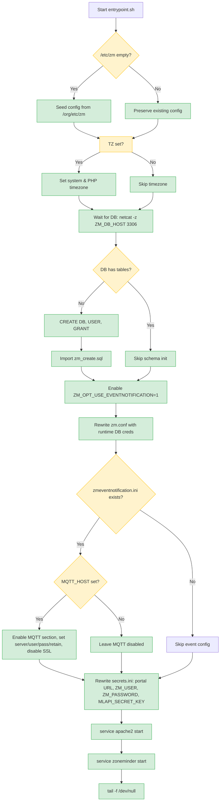

# Entrypoint Flow

This document provides a detailed trace of `entrypoint.sh`, the PID 1 process that initializes the ZoneMinder container environment and launches all services. The script runs sequentially with conditional branches for first-run setup, database initialization, and MQTT configuration.

## Execution Overview



**Caption:** Entrypoint initialization sequence with conditional branches for config seeding, timezone, database bootstrap, and MQTT setup.

---

## Phase 1: Config Seeding (First-Run Initialization)

```bash
if [ -z "$(ls -A /etc/zm)" ]; then
   cp -R /org/etc/zm/* /etc/zm/
fi
```

**Purpose**: On first container startup with a fresh `zm_config` volume, `/etc/zm` is empty. The script seeds it from the pristine backup at `/org/etc/zm` (created at image build time by the Dockerfile).

**Behavior**:
- Runs only when `/etc/zm` contains zero entries (`ls -A` shows nothing).
- Preserves user customizations on subsequent starts — the volume already has files, so the guard skips the copy.
- Files seeded include `zm.conf`, `zmeventnotification.ini`, `secrets.ini`, and any Apache/SSL configs under `conf.d/`.

**Evidence**: [repo://entrypoint.sh#L7-L11]

---

## Phase 2: Timezone Configuration

```bash
if [ -n "$TZ" ]; then
    echo $TZ > /etc/timezone
    rm -rf /etc/localtime
    ln -s /usr/share/zoneinfo/$TZ /etc/localtime
    dpkg-reconfigure --frontend noninteractive tzdata

    find /etc -name "php.ini" | while read -r filepath
    do
        grep -q "^[;]*\s*date.timezone " "${filepath}"
        if [ $? -eq 0 ]; then
            sed -i "s|^[;]*\s*date.timezone .*|date.timezone = ${TZ}|g" "${filepath}"
        else
            echo "date.timezone = ${TZ}" >> "${filepath}"
        fi
    done
fi
```

**Purpose**: Applies the `TZ` environment variable (e.g., `Europe/Berlin`) to the system timezone and all PHP `php.ini` files.

**Details**:
1. Writes `$TZ` to `/etc/timezone`.
2. Replaces `/etc/localtime` symlink to point at the correct zoneinfo file.
3. Runs `dpkg-reconfigure tzdata` non-interactively to update system timezone data.
4. Finds every `php.ini` under `/etc` and ensures `date.timezone = $TZ` is set (uncomments if commented, adds if missing).

**Required**: No — if `TZ` is unset, the block is skipped and the container defaults to UTC.

**Evidence**: [repo://entrypoint.sh#L16-L42]

---

## Phase 3: Database Wait Loop (netcat)

```bash
until netcat -z ${ZM_DB_HOST} 3306; do
  echo "Waiting for MariaDB server to start..."
  sleep 1
done
```

**Purpose**: Blocks until the MariaDB server (typically the `db` service in docker-compose) accepts TCP connections on port 3306.

**Mechanism**:
- `netcat -z` performs a zero-I/O TCP connection test (no data sent).
- Loop sleeps 1 second between attempts.
- Runs indefinitely until the DB is reachable.

**Variables**: Requires `ZM_DB_HOST` (default `db` in compose).

**Evidence**: [repo://entrypoint.sh#L47-L51]

---

## Phase 4: Database Bootstrap & Table-Count Check

```bash
table_count=$(mysql -h "$ZM_DB_HOST" -u "$ZM_DB_USER" -p"$ZM_DB_PASS" -e "SELECT COUNT(*) FROM information_schema.tables WHERE table_schema = '$ZM_DB_NAME';" -s)

if [ "$table_count" -gt 0 ]; then
  echo "There are $table_count tables in the $ZM_DB_NAME database"
else
  echo "There are no tables in the $ZM_DB_NAME database"
  mysql -u root -p${MYSQL_ROOT_PASSWORD} -h ${ZM_DB_HOST} -e "CREATE DATABASE IF NOT EXISTS ${ZM_DB_NAME}; CREATE USER IF NOT EXISTS '${ZM_DB_USER}'@'%' IDENTIFIED BY '${ZM_DB_PASS}'; GRANT ALL PRIVILEGES ON ${ZM_DB_NAME}.* TO '${ZM_DB_USER}'@'%'; FLUSH PRIVILEGES;"
  mysql -u ${ZM_DB_USER} -p${ZM_DB_PASS} -h ${ZM_DB_HOST} ${ZM_DB_NAME} < /usr/share/zoneminder/db/zm_create.sql
fi
```

**Purpose**: Determines whether the ZoneMinder database schema exists. If empty, creates the database, user, grants, and imports the canonical schema.

**Logic**:
1. Queries `information_schema.tables` for the count of tables in `ZM_DB_NAME` using the ZoneMinder DB user credentials.
2. **If tables exist (>0)**: Logs the count and skips initialization — assumes schema is already provisioned.
3. **If empty (0)**: 
   - Connects as MySQL `root` (requires `MYSQL_ROOT_PASSWORD`) to create the database, user, and grants.
   - Imports `/usr/share/zoneminder/db/zm_create.sql` as the ZoneMinder user to populate tables.

**Variables Required**:
- `ZM_DB_HOST`, `ZM_DB_NAME`, `ZM_DB_USER`, `ZM_DB_PASS` — for the table count query and import.
- `MYSQL_ROOT_PASSWORD` — for the root-level CREATE DATABASE/USER/GRANT statements.

**Evidence**: [repo://entrypoint.sh#L53-L70]

---

## Phase 5: Enable Event Notification Feature Flag

```bash
mysql -u ${ZM_DB_USER} -p${ZM_DB_PASS} -h ${ZM_DB_HOST} ${ZM_DB_NAME} -e \
"UPDATE Config SET Value = '1' WHERE Name = 'ZM_OPT_USE_EVENTNOTIFICATION';"
```

**Purpose**: Ensures the ZoneMinder option `ZM_OPT_USE_EVENTNOTIFICATION` is enabled (value `1`) in the DB `Config` table. This allows ZoneMinder to push events to `zmeventnotification`.

**Runs**: Unconditionally after DB bootstrap (whether schema was created or pre-existing).

**Evidence**: [repo://entrypoint.sh#L72-L75]

---

## Phase 6: Rewrite zm.conf with Runtime Credentials

```bash
sed -i "s/ZM_DB_HOST=.*/ZM_DB_HOST=$ZM_DB_HOST/" /etc/zm/zm.conf
sed -i "s/ZM_DB_USER=.*/ZM_DB_USER=$ZM_DB_USER/" /etc/zm/zm.conf
sed -i "s/ZM_DB_PASS=.*/ZM_DB_PASS=$ZM_DB_PASS/" /etc/zm/zm.conf
sed -i "s/ZM_DB_NAME=.*/ZM_DB_NAME=$ZM_DB_NAME/" /etc/zm/zm.conf
```

**Purpose**: Overwrites the four DB connection keys in `/etc/zm/zm.conf` with the runtime environment variable values. The seeded config contains placeholder/default values; this step makes them match the actual deployment.

**Pattern**: Each `sed` matches the key prefix (e.g., `ZM_DB_HOST=`) and replaces the entire line.

**Evidence**: [repo://entrypoint.sh#L77-L80]

---

## Phase 7: Configure zmeventnotification.ini (MQTT)

```bash
if [ -e "/etc/zm/zmeventnotification.ini" ]; then
  if [ -n "$MQTT_HOST" ]; then
    sed -i "/\[mqtt\]/,/^\[/ s/^#*\s*enable\s*=.*/enable = yes/" /etc/zm/zmeventnotification.ini
    sed -i "/\[mqtt\]/,/^\[/ s/^#*\s*server\s*=.*/server = $MQTT_HOST/" /etc/zm/zmeventnotification.ini
    sed -i "/\[mqtt\]/,/^\[/ s/^#*\s*username\s*=.*/username = $MQTT_USER/" /etc/zm/zmeventnotification.ini
    sed -i "/\[mqtt\]/,/^\[/ s/^#*\s*password\s*=.*/password = $MQTT_PASSWORD/" /etc/zm/zmeventnotification.ini
    sed -i "/\[mqtt\]/,/^\[/ s/^#*\s*retain\s*=.*/retain = yes/" /etc/zm/zmeventnotification.ini
    sed -i "/\[ssl\]/,/^\[/ s/^#*\s*enable\s*=.*/enable = no/" /etc/zm/zmeventnotification.ini
  fi
  ...
fi
```

**Purpose**: Dynamically configures the `[mqtt]` section of `zmeventnotification.ini` when `MQTT_HOST` is provided (typically `eclipse-mosquitto` in docker-compose).

**Sed Range Addressing**: `/\[mqtt\]/,/^\[/` restricts replacements to lines between the `[mqtt]` header and the next section header (`^\[`). This avoids clobbering other sections.

**Changes Applied**:
| Key | Value | Notes |
|-----|-------|-------|
| `enable` | `yes` | Uncomments and sets |
| `server` | `$MQTT_HOST` | e.g., `eclipse-mosquitto` |
| `username` | `$MQTT_USER` | From env |
| `password` | `$MQTT_PASSWORD` | From env |
| `retain` | `yes` | MQTT retain flag |
| `ssl` → `enable` | `no` | Disables TLS in `[ssl]` section |

**Conditional**: Only runs if `MQTT_HOST` is non-empty. If unset, the MQTT section remains disabled (default in seeded config).

**Evidence**: [repo://entrypoint.sh#L91-L106]

---

## Phase 8: Rewrite secrets.ini

```bash
sed -i 's|https://portal/|http://zoneminder/|g' /etc/zm/secrets.ini
sed -i "s/^ZM_USER=.*/ZM_USER=${ZM_USER}/" /etc/zm/secrets.ini
sed -i "s/^ZM_PASSWORD=.*/ZM_PASSWORD=${ZM_PASSWORD}/" /etc/zm/secrets.ini
SECRET_KEY=$(openssl rand -base64 32)
if grep -q 'MLAPI_SECRET_KEY' /etc/zm/secrets.ini; then
  sed -i "s/^MLAPI_SECRET_KEY=.*/MLAPI_SECRET_KEY=${SECRET_KEY}/" /etc/zm/secrets.ini
else
  echo "MLAPI_SECRET_KEY=${SECRET_KEY}" >> /etc/zm/secrets.ini
fi
```

**Purpose**: Updates `secrets.ini` with runtime credentials and a generated ML API secret.

**Changes**:
1. **Portal URL**: Replaces `https://portal/` with `http://zoneminder/` (internal Docker DNS name for the ZoneMinder web UI).
2. **ZM_USER / ZM_PASSWORD**: Overwrites with values from environment (typically `admin` / secure password).
3. **MLAPI_SECRET_KEY**: Generates a 32-byte base64 key via `openssl rand -base64 32`. Updates existing line or appends if missing.

**Evidence**: [repo://entrypoint.sh#L108-L117]

---

## Phase 9: Service Startup

```bash
service apache2 start
service zoneminder start
tail -f /dev/null
```

**Purpose**: Launches the two core services and keeps the container alive.

**Sequence**:
1. **Apache** (`service apache2 start`): Starts the web server serving the ZoneMinder UI on port 80 and API/WebSocket on port 9000.
2. **ZoneMinder** (`service zoneminder start`): Starts ZM daemons (`zmc` capture, `zma` analysis, `zms` streaming, `zmwatch` watchdog, etc.) via the SysV init script.
3. **tail -f /dev/null**: Blocks indefinitely as PID 1, preventing container exit. Docker healthcheck probes `http://localhost/zm/`.

**Note**: The ML API (`mlapi.py`) and `zmeventnotification.pl` are commented out in the entrypoint. They are typically run as separate containers/processes.

**Evidence**: [repo://entrypoint.sh#L121-L125]

---

## Environment Variable Reference

| Variable | Phase | Required | Description |
|----------|-------|----------|-------------|
| `TZ` | 2 | No | IANA timezone (e.g., `Europe/Berlin`) |
| `ZM_DB_HOST` | 3, 4, 5, 6 | Yes | MariaDB hostname (e.g., `db`) |
| `ZM_DB_NAME` | 4, 6 | Yes | Database name (e.g., `zm`) |
| `ZM_DB_USER` | 4, 6 | Yes | DB user for ZM (e.g., `zmuser`) |
| `ZM_DB_PASS` | 4, 6 | Yes | DB user password |
| `MYSQL_ROOT_PASSWORD` | 4 | Yes | Root password for CREATE DATABASE/USER |
| `ZM_USER` | 8 | Yes | ZoneMinder web UI username (e.g., `admin`) |
| `ZM_PASSWORD` | 8 | Yes | ZoneMinder web UI password |
| `MQTT_HOST` | 7 | No | MQTT broker hostname (e.g., `eclipse-mosquitto`) |
| `MQTT_USER` | 7 | If MQTT_HOST | MQTT username |
| `MQTT_PASSWORD` | 7 | If MQTT_HOST | MQTT password |

---

## Failure Modes & Troubleshooting

| Symptom | Likely Phase | Diagnosis |
|---------|--------------|-----------|
| `netcat` loop never exits | 3 | MariaDB not started, wrong `ZM_DB_HOST`, network policy blocking 3306 |
| `mysql` table count fails | 4 | Wrong `ZM_DB_USER`/`ZM_DB_PASS`, DB exists but user lacks perms |
| `CREATE DATABASE` fails | 4 | Wrong `MYSQL_ROOT_PASSWORD`, root not allowed from `%` host |
| `zm_create.sql` import fails | 4 | Schema version mismatch, corrupted SQL file |
| `ZM_OPT_USE_EVENTNOTIFICATION` not enabled | 5 | DB connection works but UPDATE silent — check `Config` table exists |
| Apache fails to start | 9 | Port 80 conflict, missing SSL cert, PHP module load error |
| ZoneMinder service fails | 9 | DB connection failed, `zm.conf` creds wrong, shared memory (`/dev/shm`) too small |
| Healthcheck fails | Post-9 | Apache or ZM not fully up within 60s; check `docker-compose logs zoneminder` |

---

## Related Pages

- [Container Design](../architecture/container-design.md) — Multi-stage Dockerfile and config backup pattern.
- [Deployment Guide](../operations/deployment.md) — `.env` schema, docker-compose commands, healthcheck.
- [Event Notifications](../integrations/event-notifications.md) — zmeventnotification, MQTT, and hook integration.
