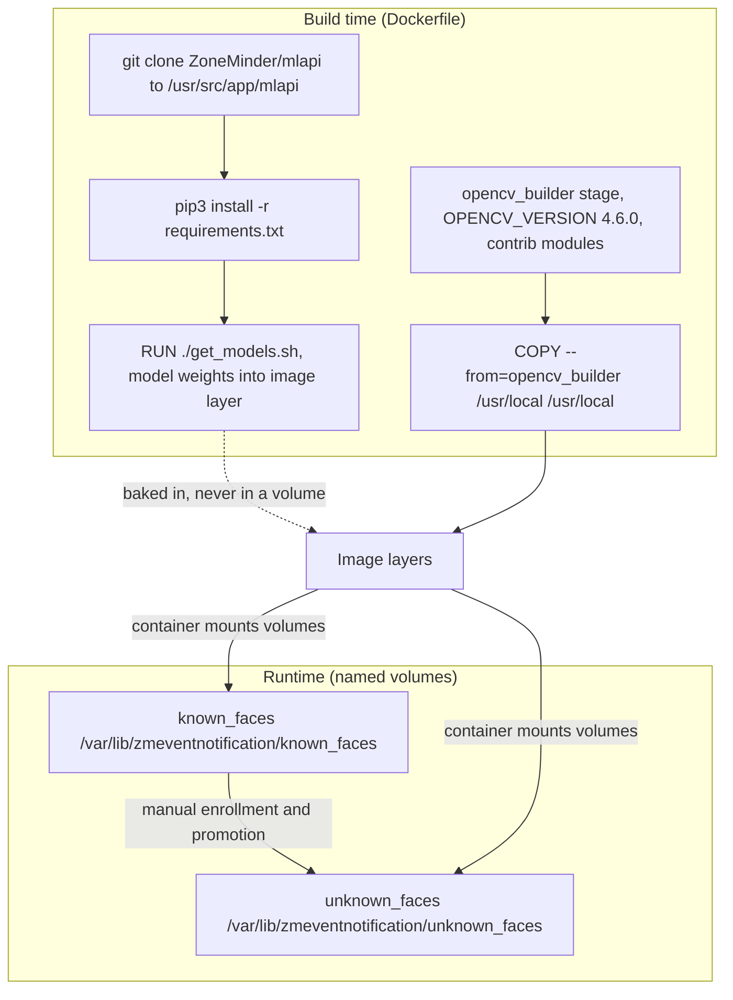

# ML Model Management

This page covers how the ML artifacts of the ZoneMinder container are acquired and managed: the **build-time model download** (`get_models.sh`), the **persistent volumes** for face recognition reference data (`known_faces` / `unknown_faces`), and the **model update strategy** (rebuild vs. runtime volume editing). The companion page [ML/AI Pipeline](../architecture/ml-pipeline.md) documents how these models are actually invoked at inference time; [Container Design](../architecture/container-design.md) covers the multi-stage Dockerfile in detail.

## Artifact Lifecycle Overview

The central property of ML model management in this stack is a lifecycle split: heavy, versioned inference assets are baked into the image, while operational face data lives in named volumes.



**Caption:** Build-time artifacts are baked into image layers; runtime face data lives in named volumes mounted by the `zoneminder` service. The lifecycle split is why model updates require a rebuild while face data survives rebuilds.

The inference-time behavior of these components is covered in [ML/AI Pipeline](../architecture/ml-pipeline.md).

---

## Model Acquisition at Build Time (`get_models.sh`)

During the Docker build, the `mlapi` repository is cloned and its `get_models.sh` script executes to download pre-trained model weights into the mlapi working directory. These weights are **baked into the image** — they are not stored in Docker volumes and do not persist across image rebuilds.

```dockerfile
# From Dockerfile (lines 94-101)
COPY --from=opencv_builder /usr/local /usr/local
# Clone the repository
RUN git clone https://github.com/ZoneMinder/mlapi.git .
# Install any needed packages specified in requirements.txt
RUN pip3 install --no-cache-dir -r requirements.txt
#RUN pip3 install --no-cache-dir opencv-python-headless
RUN ./get_models.sh
```

### What `get_models.sh` Downloads

The script itself is **not in this repository** — it comes from the upstream [ZoneMinder/mlapi](https://github.com/ZoneMinder/mlapi) clone at `/usr/src/app/mlapi` and runs there during build (external behavior; its exact download list is defined upstream and could change independently of this repo's Dockerfile). Per the upstream mlapi project, the model set covers:

| Model | Files (upstream) | Purpose |
|-------|------------------|---------|
| **YOLOv4-tiny (object detection)** | `yolov4-tiny.weights`, `yolov-tiny.cfg` (exact names per upstream `get_models.sh`) | General object detection (person, car, dog, etc.) via OpenCV DNN |
| **Face detector (OpenCV DNN)** | `opencv_face_detector_uint8.pb` + `opencv_face_detector.pbtxt` | Detects face bounding boxes in frames |
| **Face embedding (OpenFace)** | `nn4.small2.v1.t7` (Torch7 model) | Computes 128-d embeddings for face recognition |

These files land in the mlapi working directory (`/usr/src/app/mlapi/`) and are loaded at runtime by the mlapi application.

### Implications

- **Models are immutable at runtime** — you cannot update YOLO weights or face models by replacing files in a volume; the container reads from the image layer.
- **Updating models requires a rebuild** — change the mlapi git reference (or a forked `get_models.sh`), then rebuild the image; the standard compose override builds from the local Dockerfile (`docker-compose build` / `docker-compose up -d --build`).
- **OpenCV version pinning** — the Dockerfile pins `OPENCV_VERSION=4.6.0` in the `opencv_builder` stage (see below); upgrading OpenCV is a full rebuild of that stage and the final image.

---

## Face Recognition Volumes: `known_faces` / `unknown_faces`

Unlike model weights, **face reference images** (photos of known people used for recognition) and **unknown face crops** (unrecognized faces saved for review) are stored in Docker named volumes so they survive container recreation and image rebuilds.

### Volume Definitions (docker-compose.yml)

```yaml
# zoneminder service volumes (lines 34-35)
  - known_faces:/var/lib/zmeventnotification/known_faces
  - unknown_faces:/var/lib/zmeventnotification/unknown_faces
```

and are declared in the top-level `volumes:` block (lines 56-57):

```yaml
volumes:
  ...
  known_faces:
  unknown_faces:
```

### `known_faces` Volume

- **Mount path:** `/var/lib/zmeventnotification/known_faces`
- **Purpose:** Stores reference images for known individuals, conventionally organized as one subdirectory per person (e.g., `known_faces/John/`). The README describes this volume as storing "known face recognition data".
- **Population:** Manually curated by administrators — typically by placing images directly into the volume (e.g., `docker cp photo.jpg zoneminder:/var/lib/zmeventnotification/known_faces/John/`). The face-recognition tooling builds its reference embeddings from this tree.
- **Usage at runtime:** mlapi (the Flask application at `/usr/src/app/mlapi`, configured via `mlapiconfig.ini`) builds face-recognition reference embeddings from this directory — in mlapi's design, at startup and/or via a train/reload action.

### `unknown_faces` Volume

- **Mount path:** `/var/lib/zmeventnotification/unknown_faces`
- **Purpose:** When face detection finds a face that does **not** match any known person, the cropped face image is saved here for review. README describes it as the volume for "unknown face recognition data".
- **Operational feedback loop:** Operators review this directory and move good crops into `known_faces/<name>/` to teach the system a new identity; then trigger a reload (restart mlapi or its train action) so reference embeddings pick up the new person.

### Volume Persistence

Both are **Docker named volumes** declared in the compose top-level `volumes:` block. Data persists across:

- Container stop/start
- Container removal/recreation (`docker-compose down && docker-compose up -d`)
- Image rebuilds (as long as the volume itself is not removed)

---

## Model Update Strategy: Rebuild vs. Volume Editing

| Artifact | Stored In | Update Mechanism |
|----------|-----------|------------------|
| **Model weights** (YOLO, face detector, face embedding) | Image layer (`/usr/src/app/mlapi/`, from `get_models.sh`) | **Rebuild image** — change the mlapi git reference or a forked `get_models.sh`, then rebuild |
| **OpenCV libraries / Python bindings** | Image layer (`/usr/local/`, from the `opencv_builder` stage) | **Rebuild image** — change `OPENCV_VERSION` and rebuild the full image |
| **Known face reference images** | `known_faces` volume | **Runtime** — add/remove files in the volume, then have mlapi reload/train |
| **Unknown face crops** | `unknown_faces` volume | **Runtime** — written by mlapi automatically; reviewed and promoted manually |

### Why This Split?

- **Model weights** are large, versioned artifacts that should be reproducible; baking them into the image ensures every container runs the same model version and that the build (not a runtime edit) is the source of truth.
- **Face reference data** is operational state that grows over time as people are enrolled; volumes let this evolve without rebuilding images.

---

## OpenCV Version Pinning and Rebuild Implications

The Dockerfile uses a **multi-stage build** with a dedicated `opencv_builder` stage:

```dockerfile
# Stage 1: opencv_builder (Dockerfile lines 1-58)
FROM ubuntu:22.04 as opencv_builder
ENV OPENCV_VERSION=4.6.0
# ... downloads, compiles, installs to /usr/local

# Stage 2: final stage (Dockerfile lines 62+)
FROM ubuntu:22.04
...
COPY --from=opencv_builder /usr/local /usr/local
```

### Pinned Version

- `OPENCV_VERSION=4.6.0` is hardcoded in the `ENV` directive at Dockerfile line 6.
- OpenCV contrib modules are fetched from the matching tag (`opencv_contrib-4.6.0`) and built into the same install tree, enabling the contrib face module mlapi uses for face recognition.

### Rebuild Triggers

| Change | Required Action |
|--------|-----------------|
| Update `OPENCV_VERSION` (e.g., 4.6.0 → 4.8.0) | Full rebuild — rebuilds the `opencv_builder` stage and the final stage |
| Modify mlapi git reference or `get_models.sh` | Rebuild — re-runs the clone and model download |
| Change mlapi Python `requirements.txt` | Rebuild — re-installs Python deps |
| Add/remove face reference images | **No rebuild** — edit the `known_faces` volume directly |

### Compatibility Notes

- mlapi uses OpenCV's **DNN module** (`readNetFromDarknet`, `readNetFromTensorflow`, `readNetFromTorch` per upstream mlapi usage) for both object detection and face recognition.
- The OpenCV build enables `BUILD_opencv_python3` so the `cv2` Python module is present for mlapi; `WITH_CUDA=OFF` keeps inference CPU-only.
- If you upgrade OpenCV, test that mlapi starts and detection works before deploying — the DNN API is stable across OpenCV 4.x, but a new OpenCV version can still change behavior or introduce build issues.

---

## Runtime Configuration for Models

mlapi reads its own runtime configuration from `/usr/src/app/mlapi/mlapiconfig.ini` (per the upstream mlapi layout; the entrypoint's commented mlapi launch line references this file). Per upstream mlapi defaults, the `[object]` and `[face]` sections point model paths at the build-time download location under `/usr/src/app/mlapi/`, plus a `face_min_confidence` threshold for the recognition match. These paths point into the image filesystem, reinforcing the rebuild-to-update invariant: to change which model files mlapi uses, you rebuild the image (or replace files inside a container, which is not persistent).

---

## Operational Checklist

- [ ] **Initial deployment:** run `docker-compose up -d` — models download at build; volumes are created (empty) on first use.
- [ ] **Enroll known faces:** add reference images under `known_faces/<person>/` directly in the volume.
- [ ] **Trigger face training:** restart mlapi or invoke its train action so reference embeddings pick up new reference images.
- [ ] **Review unknown faces:** check `unknown_faces/` periodically; promote good crops into `known_faces/<name>/` and reload/train.
- [ ] **Model updates:** to upgrade YOLO or face models, change the mlapi git reference (or fork and edit `get_models.sh`), then rebuild the image.
- [ ] **OpenCV upgrades:** change `OPENCV_VERSION` in the Dockerfile, rebuild the full image, and validate that mlapi starts and detection works.
- [ ] **Remember:** mlapi is **not started automatically** — `entrypoint.sh` only configures the pipeline; the mlapi launch line is commented out (see [Entrypoint Flow](entrypoint-flow.md)). Start it manually before expecting inference.

---

## Related Pages

- [ML/AI Pipeline](../architecture/ml-pipeline.md) — End-to-end inference flow, hook → mlapi → MQTT
- [Container Design](../architecture/container-design.md) — Multi-stage Dockerfile, OpenCV builder stage
- [Deployment](deployment.md) — Bringing the stack up and the compose override
- [Entrypoint Flow](entrypoint-flow.md) — What `entrypoint.sh` configures and actually starts
- [Troubleshooting](troubleshooting.md) — Diagnosing mlapi, hook, and MQTT issues
