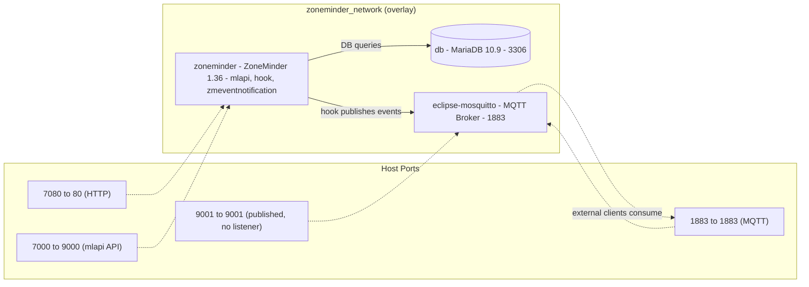

# Quickstart

This page is a **task router** for coding agents working on the containerized ZoneMinder stack. It maps common workflows to the detailed wiki pages that explain the mechanisms, configuration, and extension points.

The stack consists of three services on a shared overlay network (`zoneminder_network`, `overlay` driver, `attachable: true`):
- **MariaDB** (`db`, image `mariadb:10.9`) — persistent database
- **ZoneMinder** (`zoneminder`, built from `Dockerfile`) — surveillance application, mlapi, event hooks
- **Eclipse Mosquitto** (`eclipse-mosquitto`, built from `Dockerfile.mosquitto`) — MQTT broker for event notifications

Two Compose files define the stack:
- `docker-compose.yml` — base service definitions, environment, six named volumes (`db_data`, `zm_config`, `zm_cache`, `known_faces`, `unknown_faces`, `mosquitto_data`), and a ~400 MB `tmpfs` at `/dev/shm`
- `docker-compose.override.yml` — build config and host port mappings (7080→80, 7000→9000, 1883→1883, 9001→9001)

---

## Task → Wiki Page Map

| Task | Start Here | Key Details |
|------|------------|-------------|
| **Deploy / bring up the stack** | [Deployment Guide](operations/deployment.md) | `.env` schema, `docker-compose up -d`, port mappings, healthcheck behavior |
| **Understand the service topology** | [System Overview](architecture/system-overview.md) | Three-service architecture, network/volume layout, inter-service communication paths |
| **Trace container startup (PID 1)** | [Entrypoint Flow](operations/entrypoint-flow.md) | `entrypoint.sh` phases: config seeding, timezone, DB bootstrap, MQTT config, service launch |
| **Debug database issues** | [Troubleshooting → DB](operations/troubleshooting.md#1-database-connection-failures) | `netcat` wait loop, `zm_create.sql` import, credential mapping, `db_data` volume persistence |
| **Debug config persistence** | [Troubleshooting → Config](operations/troubleshooting.md#2-configuration-not-persisting) | Named volumes vs bind mounts, first-run seeding guard, permission expectations |
| **Manage database schema / credentials** | [Database Integration](integrations/database.md) | `zm_create.sql` bootstrap, `zm.conf` connection config, root vs app user separation, table-count initialization check |
| **Extend / swap ML models** | [ML Model Management](operations/ml-model-management.md) | Build-time `get_models.sh`, immutable model weights in the image, `known_faces`/`unknown_faces` volumes for runtime face data |
| **Understand the ML inference pipeline** | [ML/AI Pipeline](architecture/ml-pipeline.md) | `mlapi` Flask + OpenCV DNN, YOLO object detection, face embeddings, hook → MQTT flow |
| **Configure event notifications / MQTT** | [Event Notifications & MQTT](integrations/event-notifications.md) | `zmeventnotification` server + hook, `zmeventnotification.ini` and `secrets.ini` rewrites, Mosquitto password auth, `zoneminder/#` topic flow |
| **Debug ML API / event hook / MQTT failures** | [Troubleshooting](operations/troubleshooting.md) | `mlapi` health, hook script execution, MQTT auth, `MLAPI_SECRET_KEY` rotation, port/timezone issues |
| **Modify container build (OpenCV, ZM version, Perl deps)** | [Container Design](architecture/container-design.md) | Multi-stage Dockerfile: OpenCV builder stage → ZoneMinder 1.36 runtime → mlapi → zmeventnotification → entrypoint; the separate mosquitto image |

---

## Common Commands

```bash
# Start the stack (builds the zoneminder and eclipse-mosquitto images on first run)
docker-compose up -d

# View logs for a specific service
docker-compose logs -f zoneminder
docker-compose logs -f db
docker-compose logs -f eclipse-mosquitto

# Check container status and health
docker-compose ps

# Stop and remove containers (keeps named volumes)
docker-compose down

# Stop and remove everything including volumes (destructive)
docker-compose down -v

# Rebuild the ZoneMinder image after Dockerfile changes
docker-compose build --no-cache zoneminder
docker-compose up -d

# Execute commands inside the zoneminder container
docker-compose exec zoneminder bash

# Test MariaDB connectivity from the zoneminder container
docker-compose exec zoneminder mysql -h db -u "$ZM_DB_USER" -p"$ZM_DB_PASS" "$ZM_DB_NAME" -e "SELECT 1;"

# Test the MQTT broker (password auth required)
docker-compose exec eclipse-mosquitto mosquitto_sub -u "$MQTT_USER" -P "$MQTT_PASSWORD" -t 'zoneminder/#' -C 1 -v

# Inspect named volume contents
docker run --rm -v zm_config:/data alpine ls -la /data
docker run --rm -v known_faces:/data alpine ls -la /data
```

---

## Required `.env` File

Create `.env` in the project root (alongside `docker-compose.yml`) with:

```bash
MYSQL_ROOT_PASSWORD=<strong_root_pw>
MYSQL_DATABASE=zm
MYSQL_USER=zmuser
MYSQL_PASSWORD=<zmuser_pw>
TZ=Europe/Berlin
MQTT_USER=mqtt_user
MQTT_PASSWORD=<mqtt_pass>
ZM_USER=admin
ZM_PASSWORD=<admin_pw>
```

All variables are required. The `zoneminder` entrypoint consumes them to configure `/etc/zm/zm.conf`, `/etc/zm/zmeventnotification.ini`, and `/etc/zm/secrets.ini` at every startup; the `eclipse-mosquitto` entrypoint consumes `MQTT_USER`/`MQTT_PASSWORD` to build its password file. The runtime hostnames `ZM_DB_HOST=db` and `MQTT_HOST=eclipse-mosquitto` are hard-coded in `docker-compose.yml`, not sourced from `.env`. `TZ` is passed to `db` and `zoneminder` only — the mosquitto service does not receive it.

---

## Access Points

| Service | URL | Notes |
|---------|-----|-------|
| ZoneMinder Web UI | http://localhost:7080/zm/ | Login with `ZM_USER` / `ZM_PASSWORD`; also the healthcheck target |
| mlapi API | http://localhost:7000/ | Maps to container port 9000 (the mlapi Flask service); also the hook's detection endpoint internally |
| MQTT Broker | localhost:1883 | Auth: `MQTT_USER` / `MQTT_PASSWORD`; topic namespace `zoneminder/<event_id>` |
| MQTT over WebSocket | localhost:9001 | **Published but unused by default** — the generated `mosquitto.conf` defines only `listener 1883`; add a WebSocket listener and rebuild the mosquitto image to use it |

---

## Architecture at a Glance



---

## Key Gotchas

1. **The `exec "$@"` boundary.** `entrypoint.sh` runs `exec "$@"` after the DB bootstrap phase. Because the Dockerfile declares `ENTRYPOINT ["entrypoint.sh"]` with no `CMD`, this is a no-op in the normal path. If you start the container with a command override (`docker-compose run`, explicit `command:`), the shell is replaced and **every later phase is skipped**: the `zm.conf` rewrite, MQTT/secrets.ini configuration, `service apache2 start`, `service zoneminder start`, and the `tail -f /dev/null` keep-alive. See [Entrypoint Flow](operations/entrypoint-flow.md).
<!-- openwiki: broken internal link [operations/troubleshooting.md#3-ml-api-mlapi-not-starting-object-detection-failing] heading anchor "3-ml-api-mlapi-not-starting-object-detection-failing" does not exist in "operations/troubleshooting.md". Fix the href or restore the target, then delete this comment. -->
2. **mlapi and the event server are not started by default.** Both `python3 .../mlapi.py` and `zmeventnotification.pl` launch lines are commented out in `entrypoint.sh`. Only Apache and ZoneMinder start out of the box; the ML/event pipeline must be launched via a supervisor, manually, or as a sidecar. See [ML/AI Pipeline](architecture/ml-pipeline.md) and [Troubleshooting](operations/troubleshooting.md#3-ml-api-mlapi-not-starting-object-detection-failing).
3. **`MLAPI_SECRET_KEY` rotates every startup.** The entrypoint regenerates it with `openssl rand -base64 32` and writes it to `/etc/zm/secrets.ini`. Any mlapi instance must share the `zm_config` volume or use a fixed key; otherwise hook→mlapi authentication breaks after a restart.
4. **First-run config seeding is guarded by an empty-directory check.** `/org/etc/zm/*` is copied to `/etc/zm` only when `/etc/zm` is empty — with the `zm_config` volume mounted correctly, existing config is kept. See [Troubleshooting → Config](operations/troubleshooting.md#2-configuration-not-persisting).
5. **Port 9001 is published but has no listener.** `entrypoint_mosquitto.sh` generates `mosquitto.conf` with only `listener 1883` plus a password file. See the Port Map in [Troubleshooting](operations/troubleshooting.md#port-map-docker-composeoverrideyml).
6. **Model weights live in the image, not in volumes.** `get_models.sh` runs at build time; updating YOLO weights or face models requires an image rebuild, while `known_faces`/`unknown_faces` persist across rebuilds. See [ML Model Management](operations/ml-model-management.md).

---

## Next Steps

1. **First deploy**: Follow [Deployment Guide](operations/deployment.md) to create `.env` and run `docker-compose up -d`.
2. **Verify health**: Check `docker-compose ps` — all three services should be `Up`; the ZoneMinder healthcheck (`--interval=1m --timeout=10s --retries=3`) hits `http://localhost/zm/`.
3. **Explore the UI**: Open http://localhost:7080/zm/, add a camera, trigger an event.
4. **Observe events**: Subscribe to the MQTT topic `zoneminder/#` to see enriched event payloads published (retained) by the hook.
5. **Extend ML**: To update YOLO weights or face models, see [ML Model Management](operations/ml-model-management.md) — requires an image rebuild.
6. **Customize config**: ZoneMinder config lives in the `zm_config` volume. Changes via the UI persist, and the entrypoint re-applies env-driven rewrites to `/etc/zm/` on every startup.

---

## Related Pages

- [System Overview](architecture/system-overview.md) — Service topology, network, volumes
- [Container Design](architecture/container-design.md) — Multi-stage Dockerfile breakdown
- [ML/AI Pipeline](architecture/ml-pipeline.md) — Inference flow, model paths, `MLAPI_SECRET_KEY`
- [Event Notifications & MQTT](integrations/event-notifications.md) — Hook/server, Mosquitto config, secrets.ini
- [Database Integration](integrations/database.md) — Schema bootstrap, credentials, initialization
- [Deployment Guide](operations/deployment.md) — `.env` schema, compose commands, healthcheck
- [Entrypoint Flow](operations/entrypoint-flow.md) — Phase-by-phase startup trace
- [ML Model Management](operations/ml-model-management.md) — Build-time models, runtime face volumes
- [Troubleshooting](operations/troubleshooting.md) — Symptom→cause→fix for DB, config, ML, MQTT
